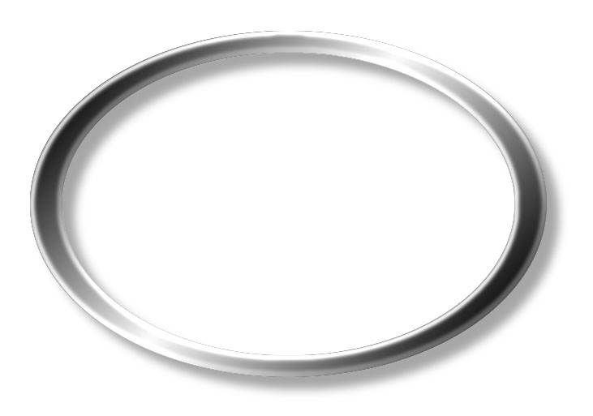

## 면접원 주지사항

1. 주소와 전화번호 확인

⑴ 조사가구의 주소와 전화번호를 정확히 확인하고 변동사항이나 수정사항은 정확히 기입하십시오.

⑵ 이사가구의 경우는 변동사항을 정확히 확인하고 기입하십시오.

2. 기존 가구인 경우

⑴ 기존 가구란 지난 조사에 포함되어 응답한 가구를 말합니다.

⑵ 먼저 info-sheet를 참조하여 지난 조사 당시의 가구원 명단을 확인합니다. (문 1.)

⑶ 가구원의 동거 여부와 지난 조사 이후 분가 또는 사망한 가구원을 파악합니다. (문 2.)

➜ 분가란 이 가구로부터 경제적으로 독립했고 따로 떨어져 사는 관계가 지속적인 상태를 말합니다. 결혼이나 이혼 등으로 따로 살게 되거나, 자녀가 장성하여 독립하는 경우 등이 이에 해당됩니다.

➜ 그러나 부부간의 일시적 별거, 군복무나 학업으로 인해 일시적으로만 떨어져 사는 경우는 분가가 아닌 비동거에 해당됩니다. 비동거 이유는 문6-1.에서 파악합니다.

⑷ 지난 조사 이후 혼인이나 출산, 입양 등으로 가구에 새로 들어온 가구원이 있는지 확인하고 응답지에 기입합니다. 또한 지난 조사시 빠진 가구원이 있는지 다시 한번 확인합니다. 가구원에 포함 여부는 아래의 기준을 따릅니다.

《 가구원 여부를 판단하는 기준 》
아래의 기준으로 가구원을 기입하십시오. 해당이 되지 않는 사람은 이름을 기입하지 마십시오.
**1. 가구원 (조사해야 할 사람)**
  가. 함께 살고 있는 친․인척 전원
(파출부, 운전사 등 고용인과 하숙생 등의 비친․인척 제외)
  나. 미혼자녀 중 교육, 군복무, 시설 및 친지위탁 등의 이유로 떨어져 살고 있는 경우
  다. 미혼자녀 중 부모로부터 경제적으로 독립하지 못한 경우
**2. 비가구원 (조사해서는 안 될 사람)**
  가. 따로 사는 미혼자녀 중 재학이나 군복무 등의 이유가 아니면서
경제적으로 독립한 경우
  나. 기혼자녀 중 따로 사는 경우

⑸ 기존의 가구원에 대해서는 문 2 응답 후 문 6부터, 문 10까지 확인 질문을 하여 주십시오. 만약 지난 번 응답과 차이가 날 경우(info-sheet의 내용과 다른 경우) ‘확인란’에 이번 조사에서 받은 응답 내용을 적어 주십시오.

➜ 가구주가 바뀌어서 가구주와의 관계가 모두 바뀌는 경우에도 가구원 각각에 대해 그 바뀐 내용을 모두 적어 주십시오.

➜ 또한 문 10의 학력 변화를 주의하여 질문해 주십시오. (예를 들어, 고등학교에서 대학교로 진학한 경우 그 변화 여부와 내용 등)

⑹ 새로 들어온 가구원(추가 가구원)에 대해서는 문 2와 문 3을 응답 후 문 6부터 문 10까지 질문합니다.

⑺ 분가한 가구원에 대해서는 문 2와 문 4를 질문합니다.

⑻ 사망한 가구원에 대해서는 문 2와 문 5를 질문합니다.

⑼ 그 후 문 11.로 가십시오.

3. 신규(분가) 가구(올해 처음 조사에 참여하는 가구)인 경우

⑴ 신규(분가) 가구는 원가구원(1998년 1차 조사 및 2009년, 2018년 추가표본가구의 가구원으로 가구용 인포시트에 "원"이라고 기재된 사람)의 분가로 형성되며, 올해 처음 조사에 참여하는 가구입니다.

⑵ 신규(분가) 가구는 새로운 가구로서 조사를 수행하며, 따라서 지난 조사의 info-sheet가 없습니다.

⑶ 위의 표에 제시된 가구원 판단 기준에 따라 가구원 여부를 결정하고 명단을 작성합니다.

⑷ 원가구원에 한해서, 신규가구의 형성(원가구원의 분가) 이후 또다시 분가한 가구원과 사망한 가구원을 파악합니다. (문 2.)

➜ 아래의 “분가 가구원의 추적”을 참조하십시오.

⑸ 각각의 가구원에 대해서 문 6부터 문 10까지 응답을 받습니다.

⑹ 그 후 곧바로 문 11로 가십시오.

※ 분가 가구원의 추적

<1> 지난 조사 이후 분가한 가구원 중 원가구원(1998년 조사 가구원 및 2009년, 2018년 추가표본 가구원, 가구용 인포시트에 "원"이라고 기재된 사람)은 반드시 추적하여야 합니다.

보기) 1998년에 서울에서 조사한 원가구(1번 가구)에서 2012년 12월에 형과 아우가 대전으로 분가하여 같은 집(2번 가구)에서 살다가, 2023년 2월(조사일 이전)에 형이 또 부산으로 분가(3번 가구)하여 나갔습니다.

이 경우 형과 동생 모두 원가구원이므로 추적해야 합니다. 또한 형은 대전에서 혼자 사는 동생(신규 가구인 2번 가구)의 분가 가구원이 됩니다.

<2> 그러나 원가구원(1998년 조사 가구원 및 2009년, 2018년 추가표본 가구원, 가구용 인포시트에 "원"이라고 기재된 사람)이 아닌 경우는 추적할 필요가 없습니다.

보기) 1998년에 서울에서 조사한 원가구에 2017년 1월 가구주의 아들이 잠시 합가하였고, 2017년 7월에 패널 설문지를 받아 조사를 하였습니다. 그러다가 그 아들이 다시 2023년 2월(조사일 이전)에 분가하였습니다. 이 경우 이 아들은 원가구원(1998년 조사 가구원)이 아니므로 추적할 필요가 없습니다.

그러나 1998년에 서울에서 조사한 원가구에 2009년 1월 가구주의 아들이 잠시 합가하였고, 2009년 7월에 패널 설문지를 받아 조사를 하였습니다. 그러다가 그 아들이 다시 2023년 2월(조사일 이전)에 분가하였습니다. 이 경우 이 아들은 원가구원(1998년 조사 가구원)은 아니지만 통합표본(2009년 조사 가구원) 이므로 추적할 필요가 있습니다.

## 가구원에 대하여 질문드리겠습니다.

∙ 인포시트가 있는 기존 가구(1998년 원표본가구 및 2009년, 2018년 추가표본가구)는 지난 조사일 이후의 변화를 답하여 주십시오.

〈 1 〉 새로 들어온 가구원이 있는 경우(문2.에서 “2”로 응답되었을 경우)는 문 3.을 질문하십시오.

〈 2 〉 분가한 가구원이 있는 경우(문2.에서 “3”으로 응답되었을 경우)는 문 4.를 질문하십시오.

〈 3 〉 사망한 가구원이 있는 경우(문2.에서 “4”로 응답되었을 경우)는 문 5.를 질문하십시오

∙ 인포시트가 없는 신규(분가) 분가 가구는 현재 같이 살고 있는 가구원에 대해 모두 질문 하십시오.

※ 신규(분가)가구의 경우에만 물어보십시오.

\_\_\_\_\_\_\_님 댁은 2024년에 새로 생긴 가구입니까?

확인1

▸ 혼인, 이혼, 장성하였거나 경제적 독립 등의 이유로 따로 나와서 사는 경우

⑴ 예 (2024년 \_\_\_\_\_\_\_\_월)

⑵ 아니오

님의 가구원은 누구누구 입니까?

확인2

\_\_\_\_\_\_\_\_\_\_\_\_\_, \_\_\_\_\_\_\_\_\_\_\_\_\_, \_\_\_\_\_\_\_\_\_\_\_\_,

◉ 가구원 각각에 대해서 문1～문7 까지 질문하세요.

\_\_\_\_\_\_\_님의 이름은 ‘◯◯◯’가 맞습니까? (신규일 경우) \_\_\_\_님의 이름은 무엇입니까?
(인포시트에 기재되어 있는 이름이 틀릴 경우에는 CAPI를 수정하고, 사유를 상세히 기록해 주세요)

문 1

\_\_\_\_\_\_\_님은 이 집에 함께 살고 계십니까?

문 2

| ⑴ | 현재 같이 살고 있다 /경제적으로 독립하지는 않은 채 일시적으로 따로 살고 있다 | → 문6.으로 가십시오. |
| --- | --- | --- |
| ⑵ | 지난 조사 이후 새로 추가되었다 | → 문3.으로 가십시오. |
| ⑶ | 현재 같이 살고 있지 않으며, 경제적으로도 독립한 상태이다 | → 문4.로 가십시오. |
| ⑷ | 지난 조사 이후 사망했다 | → 문5.로 가십시오. |

(지난 조사 이후/분가 이후) 새로 들어온 가구원이 있는 경우

(문2.에서 “2”로 응답되었을 경우) 새로 들어온 가구원에 대한 질문입니다.

문 3

▸ 신규(분가) 가구의 경우에는 응답하실 필요가 없습니다.

\_\_\_\_\_\_님께서는 언제부터 이 댁에서 함께 사셨습니까?

문3-1

￭ \_\_\_\_\_\_\_\_\_\_년 \_\_\_\_\_\_\_월

어떻게 이 댁의 가구원이 되셨습니까?

문3-2

⑴ 출생

⑵ 입양

⑶ 혼인

⑷ 합가(따로 살다가 부모님 또는 친지 댁으로 살러 들어옴)

⑸ 기타 (\_\_\_\_\_\_\_\_\_\_\_\_\_\_\_\_\_\_\_\_\_\_\_\_\_\_\_\_\_\_\_\_)

→ 문6.으로 가십시오.

(지난 조사 이후/분가 이후) 같이 살다가 분가한 원가구원이 있는 경우

(문2.에서 “3”으로 응답되었을 경우) 분가한 가구원에 대한 질문입니다.

문 4

언제 분가하셨습니까?

문4-1

￭ \_\_\_\_\_\_\_\_\_\_년 \_\_\_\_\_\_\_월

분가하게 된 이유는 무엇입니까?

문4-2

⑴ 혼인하여서 따로 살게 됨

⑵ 이혼하여서 따로 살게 됨

(3) 장성하였거나 경제적으로 독립할 여건이 되어 분가

(4) 기타 (\_\_\_\_\_\_\_\_\_\_\_\_\_\_\_\_\_\_\_\_\_\_\_\_\_\_\_\_\_\_\_\_)

이분의 연락처를 알려주시겠습니까?

문4-3

⑴ 이름		\_\_\_\_\_\_\_\_\_\_\_\_\_\_\_\_\_\_\_\_\_\_\_\_\_\_\_\_\_\_\_\_\_

⑵ 가구원 일련번호	\_\_\_\_\_\_\_\_\_\_\_\_\_\_\_\_\_\_\_\_\_\_\_\_\_\_\_\_\_\_\_\_\_

⑶ 전화번호		\_\_\_\_\_\_\_\_\_\_\_\_\_\_\_\_\_\_\_\_\_\_\_\_\_\_\_\_\_\_\_\_\_

⑷ 핸드폰		\_\_\_\_\_\_\_\_\_\_\_\_\_\_\_\_\_\_\_\_\_\_\_\_\_\_\_\_\_\_\_\_\_

⑸ 주소		\_\_\_\_\_\_\_\_\_\_\_\_\_\_\_\_\_\_\_\_\_\_\_\_\_\_\_\_\_\_\_\_\_

→ 그 다음 가구원을 질문하거나, 더 이상의 가구원이 없으면 문11로 가십시오.

(지난 조사 이후/분가 이후) 사망한 가구원이 있는 경우

(문2.에서 “4”로 응답되었을 경우) 사망한 가구원에 대한 질문입니다.

문 5

언제 사망하셨습니까?

문5-1

￭ \_\_\_\_\_\_\_\_\_\_년 \_\_\_\_\_\_\_\_\_월

주된 사망 원인은 무엇입니까?

문5-2

▸ 연세가 많으신 분이 질병(암, 당뇨, 고혈압 등)으로 돌아가신 경우는 주된 사망 원인이 ‘⑶ 질병’이 됩니다. 그러나 이렇다 할 질병이 없이 돌아가신 경우는 ‘⑴ 노환’이 됩니다.

⑴ 노환

⑵ 사고

⑶ 질병

⑷ 기타(\_\_\_\_\_\_\_\_\_\_\_\_\_\_\_\_\_\_\_\_\_\_\_\_\_)

→ 그 다음 가구원을 질문하거나, 더 이상의 가구원이 없으면 문11로 가십시오.

\_\_\_\_ 님은 이 집에 함께 살고 계십니까?

문 6

⑴ 현재 함께 살고 있다 → 문7.로 가십시오.

⑵ 경제적으로 독립하지 않은 채 일시적으로 따로 살고 있다(비동거)
 (경제적으로 독립했을 경우에는, 문2에서 “3”으로 응답되어야 합니다)

(비동거 이유) 현재 함께 살고 있지 않은 이유는 무엇입니까?

문6-1

⑴ 다른 지방에 근무

⑵ 해외 근무 중

⑶ 학업(해외 유학 포함)

⑷ 군복무

⑸ 장기입원, 요양

⑹ 별거

⑺ 가출

⑻ 양육(미취학자녀의 탁아)

⑼ 기타 ( \_\_\_\_\_\_\_\_\_\_\_\_\_\_\_\_\_\_\_\_\_\_\_\_\_\_\_\_\_\_\_\_ )

\_\_\_\_\_\_님의 성별은 무엇입니까?

문 7

⑴ 남성 		⑵ 여성

이 댁의 가구주는 누구이십니까? 그리고 다른 가구원 각각은 가구주와 어떤 관계이십니까?

문 8

▸ 가구주란 가구원 중 가구를 실질적으로 대표하는 사람을 말합니다.

### 《 가구주와의 관계 코드표 》

10. 가구주 				20. 가구주의 배우자

01. 가구주의 할아버지			03. 가구주의 배우자의 할아버지

02. 가구주의 할머니			04. 가구주의 배우자의 할머니

05. 가구주의 아버지			07. 가구주의 배우자의 아버지

06. 가구주의 어머니			08. 가구주의 배우자의 어머니

11. 가구주의 첫째 자녀			21. 가구주의 첫째 자녀의 배우자

12. 가구주의 둘째 자녀			22. 가구주의 둘째 자녀의 배우자

13. 가구주의 셋째 자녀			23. 가구주의 셋째 자녀의 배우자

(넷째=14, 다섯째=15, ...)		 (넷째=24, 다섯째=25, ...)

31. 가구주의 형제/자매			41. 가구주 배우자의 형제/자매

(첫째 =31, 둘째=32, ...)			 (첫째=41, 둘째=42...)

51. 가구주의 형제/자매의 배우자		61. 가구주 배우자의 형제/자매의 배우자

(첫째 =51, 둘째=52, ...)			 (첫째=61, 둘째=62...)

111. 가구주의 첫째 자녀의 첫째 자녀		211. 가구주 첫째 자녀의 첫째 자녀의 배우자

112. 가구주의 첫째 자녀의 둘째 자녀		212. 가구주 첫째 자녀의 둘째 자녀의 배우자

(셋째=113, 넷째는 114, ...)		 (셋째=213, 넷째는 214, ...)

121. 가구주의 둘째 자녀의 첫째 자녀		221. 가구주 둘째 자녀의 첫째 자녀의 배우자

122. 가구주의 둘째 자녀의 둘째 자녀		222. 가구주 둘째 자녀의 둘째 자녀의 배우자

(셋째=123, 넷째는 124, ...)		 (셋째=223, 넷째는 224, ...)

131. 가구주의 셋째 자녀의 첫째 자녀		231. 가구주 셋째 자녀의 첫째 자녀의 배우자

132. 가구주의 셋째 자녀의 둘째 자녀		232. 가구주 셋째 자녀의 둘째 자녀의 배우자

(셋째=133, 넷째는 134, ...)		 (셋째=233, 넷째는 234, ...)

997. 기타 친인척				998. 인척관계가 아닌 동거인

(숫자에 관계없이 동일 번호)		 (숫자에 관계없이 동일 번호)

1111. 가구주의 첫째자녀의 첫째자녀의 첫째자녀 1112. 가구주의 첫째자녀의 첫째자녀의 둘째자녀

생년월일은 언제입니까?

문 9

⑴ (① 양력, ② 음력)

⑵ \_\_\_\_\_\_\_\_년 \_\_\_\_\_\_\_월 \_\_\_\_\_\_\_일

다음은 교육수준에 관한 질문입니다.

문 10

학교는 어디까지 다니셨습니까? 혹은 다니고 계십니까?

문10-1

⑴ 미취학		→ 다음 가구원, 혹은 문11.로 가십시오.

⑵ 무학		→ 다음 가구원, 혹은 문11.로 가십시오.

⑶ 초등학교

⑷ 중학교(고등공민학교)

⑸ 고등학교

⑹ 2년제 대학, 전문대학(기능대학, 구 사범학교 포함)

⑺ 4년제 대학(구 2년제 교육대학 포함)

⑻ 대학원 석사

⑼ 대학원 박사

그 학교를 마치셨습니까? 이수 여부를 답해 주십시오.

문 10-2

⑴ 졸업 (\_\_\_\_\_\_\_\_\_\_\_\_\_년 \_\_\_\_\_\_\_\_\_\_\_\_\_\_월) → 다음 가구원, 혹은 문11.로

⑵ 수료 (\_\_\_\_\_\_\_\_\_\_\_\_\_년 \_\_\_\_\_\_\_\_\_\_\_\_\_\_월)

⑶ 중퇴 (\_\_\_\_\_\_\_\_\_\_\_\_\_년 \_\_\_\_\_\_\_\_\_\_\_\_\_\_월)

⑷ 재학 중

⑸ 휴학 중

(졸업이 아닌 경우에만) 몇 학년까지 다니셨습니까? 혹은 다니고 계십니까?

문 10-3

▸ 대학원의 석사, 박사의 경우에는 두 학기를 한 학년으로 환산하여 표기해 주십시오. 예를 들어 대학원 1, 2학기 중인 경우에는 1학년이 되며, 3, 4학기 중인 경우에는 2학년이 됩니다.

￭ \_\_\_\_\_\_\_\_\_\_ 학년

◉ 인포시트에 출력된 가구원의 경우에는 먼저 이름, 성별, 생년월일, 학력 등을 지난 조사 당시와 비교하여 확인하여 주십시오. 만약, 인포시트가 틀렸을 경우, CAPI를 수정하고, 인포시트가 틀린 이유를 상세히 기록해 주세요. (문 7.～문 10.)

◉ 빠진 가구원이 있는지 다시 한 번 확인해 주십시오.

## 다음은 귀댁의 가족관계에 대하여 질문 드리겠습니다.

※ 다음은 가구주의 부모님에 대한 질문입니다.

가구주의 부모님 중 작년 한해(2024년, 전년 1.1.\~12.31.) 동안 한 달 이상 따로 살고 계시는 분이 있으셨습니까?

문 11

⑴ 있었다

⑵ 없었다	→ 문12.로 가십시오.

따로 살고 계셨던 부모님은 누구입니까?

문11-1

⑴ 가구주의 아버지와 어머니

⑵ 가구주의 아버지

⑶ 가구주의 어머니

작년 한해(2024년, 전년 1.1.\~12.31.) 동안 가구주의 부모님과 어느 정도 왕래를 하셨습니까?

문 11-2

⑴ 자주 찾아 뵈었다 월 \_\_\_\_\_\_\_\_\_\_\_\_\_\_\_\_\_\_\_회

⑵ 가끔 찾아 뵈었다 년 \_\_\_\_\_\_\_\_\_\_\_\_\_\_\_\_\_\_\_회

⑶ 거의 찾아 뵙지 않았다

※ 하루 2회 방문은 1회로 간주하여 응답해 주십시오.

※ 다음은 가구주의 부모님과의 경제적 교류에 대한 질문입니다. (일반적으로 증여/상속을 제외한 경제적 교류를 의미하며, 예를 들어 가전제품 등을 받으시거나 드린 경우도 이를 당시의 가격으로 환산하여 포함시켜 주십시오)

작년 한해(2024년, 전년 1.1.\~12.31.) 동안 가구주의 부모님으로부터 경제적 도움을 받은 적이 있습니까?

문 11-3

(1) 있었다 (2) 없었다→ 문11-6.으로 가십시오.

부모님으로부터 경제적 도움을 받게 된 이유는 무엇이었습니까?(해당되는 것에 모두 응답)

문 11-4

(1) 생활비가 부족해서	(2) 사업 자금	(3) 주택 구입

(4) 경조사(혼인, 생일 등)	(5) 부채 상환	(6) 의료비

(7) 내구재 구입		(8) 자녀 양육비	(9) 별다른 이유 없음

(10) 기타 \_\_\_\_\_\_\_\_\_\_\_\_\_\_\_\_\_\_

작년 한해(2024년, 전년 1.1.\~12.31.) 동안 부모님으로부터 받으셨던 경제적 도움은 얼마나 되십니까?

문 11-5

￭ 현금 \_\_\_\_\_\_\_\_\_\_\_\_\_\_ 만원 		￭ 현물 \_\_\_\_\_\_\_\_\_\_\_\_\_\_ 만원

작년 한해(2024년, 전년 1.1.\~12.31.) 동안 가구주의 부모님께 경제적 도움을 드린 적이 있습니까?

문 11-6

(1) 있었다 	(2) 없었다→ 문12.로 가십시오.

부모님께 경제적 도움을 드리게 된 이유는 무엇이었습니까?(해당되는 것에 모두 응답)

문 11-7

(1) 생활비가 부족해서	(2) 사업 자금			(3) 주택 구입

(4) 경조사(환갑, 생일 등)	(5) 부채 상환			(6) 의료비

(7) 내구재 구입		(8) 자녀를 돌봐주시는 비용으로	(9) 별다른 이유 없음

(10) 기타 \_\_\_\_\_\_\_\_\_\_\_\_\_\_\_\_\_\_

작년 한해(2024년, 전년 1.1.\~12.31.) 동안 부모님께 드렸던 경제적 도움은 얼마나 되십니까?

문 11-8

￭ 현금 \_\_\_\_\_\_\_\_\_\_\_\_\_\_ 만원 		￭ 현물 \_\_\_\_\_\_\_\_\_\_\_\_\_\_ 만원

※ 다음은 가구주 배우자의 부모님에 대한 질문입니다.

가구주 배우자의 부모님 중 작년 한해(2024년, 전년 1.1.\~12.31.) 동안 한 달 이상 따로 살고 계시는 분이 있으셨습니까?

문 12

⑴ 있었다

⑵ 없었다	→ 문13.으로 가십시오.

따로 살고 계셨던 부모님은 누구입니까?

문12-1

⑴ 가구주 배우자의 아버지와 어머니

⑵ 가구주 배우자의 아버지

⑶ 가구주 배우자의 어머니

작년 한해(2024년, 전년 1.1.\~12.31.) 동안 가구주 배우자의 부모님과 어느 정도 왕래를 하셨습니까?

문 12-2

⑴ 자주 찾아 뵈었다 월 \_\_\_\_\_\_\_\_\_\_\_\_\_\_\_\_\_\_\_회

⑵ 가끔 찾아 뵈었다 년 \_\_\_\_\_\_\_\_\_\_\_\_\_\_\_\_\_\_\_회

⑶ 거의 찾아 뵙지 않았다

※ 하루 2회 방문은 1회로 간주하여 응답해 주십시오.

※ 다음은 가구주 배우자의 부모님과의 경제적 교류에 대한 질문입니다. (일반적으로 증여/상속을 제외한 경제적 교류를 의미하며, 예를 들어 가전제품 등을 받으시거나 드린 경우도 이를 당시의 가격으로 환산하여 포함시켜 주십시오)

작년 한해(2024년, 전년 1.1.\~12.31.) 동안 가구주 배우자의 부모님으로부터 경제적 도움을 받은 적이 있습니까?

문 12-3

(1) 있었다 (2) 없었다→ 문12-6.으로 가십시오.

부모님으로부터 경제적 도움을 받게 된 이유는 무엇이었습니까?(해당되는 것에 모두 응답)

문 12-4

(1) 생활비가 부족해서	(2) 사업 자금	(3) 주택 구입

(4) 경조사(혼인, 생일 등)	(5) 부채 상환	(6) 의료비

(7) 내구재 구입		(8) 자녀 양육비	(9) 별다른 이유 없음

(10) 기타 \_\_\_\_\_\_\_\_\_\_\_\_\_\_\_\_\_\_

작년 한해(2024년, 전년 1.1.\~12.31.) 동안 부모님으로부터 받으셨던 경제적 도움은 얼마나 되십니까?

문 12-5

￭ 현금 \_\_\_\_\_\_\_\_\_\_\_\_\_\_ 만원 		￭ 현물 \_\_\_\_\_\_\_\_\_\_\_\_\_\_ 만원

작년 한해(2024년, 전년 1.1.\~12.31.)동안 가구주 배우자의 부모님께 경제적 도움을 드린 적이 있습니까?

문 12-6

(1) 있었다 	(2) 없었다→ 문13.으로 가십시오.

부모님께 경제적 도움을 드리게 된 이유는 무엇이었습니까?(해당되는 것에 모두 응답)

문 12-7

(1) 생활비가 부족해서	(2) 사업 자금			(3) 주택 구입

(4) 경조사(환갑, 생일 등)	(5) 부채 상환			(6) 의료비

(7) 내구재 구입		(8) 자녀를 돌봐주시는 비용으로	(9) 별다른 이유 없음

(10) 기타 \_\_\_\_\_\_\_\_\_\_\_\_\_\_\_\_\_\_

작년 한해(2024년, 전년 1.1.\~12.31.) 동안 부모님께 드렸던 경제적 도움은 얼마나 되십니까?

문 12-8

￭ 현금 \_\_\_\_\_\_\_\_\_\_\_\_\_\_ 만원 		￭ 현물 \_\_\_\_\_\_\_\_\_\_\_\_\_\_ 만원

※ 다음은 따로 사는 자녀 대한 질문입니다. 장성하여 경제적으로 독립해 따로 살고 있는 
가구주의 자녀가 있는 경우에만 응답해 주십시오.

가구주의 자녀 중 작년 한해(2024년, 전년 1.1.\~12.31.) 동안 한 달 이상 따로 살고 있었던 자녀가 있습니까?

문 13

⑴ 있었다

⑵ 없었다	→ 문14.로 가십시오.

따로 살고 있었던 자녀는 몇 명이었습니까?

문13-1

\_\_\_\_\_\_\_\_\_\_\_\_\_\_\_\_\_\_\_\_ 명

작년 한해(2024년, 전년 1.1.\~12.31.) 그 자녀들과 어느 정도 왕래를 하셨습니까? (따로 사는 자녀들 전부와 작년 한해 동안 어느 정도 왕래하셨는지 적어 주십시오)

문 13-2

⑴ 자주 왕래했다 월 \_\_\_\_\_\_\_\_\_\_\_\_\_\_\_\_\_\_\_회

⑵ 가끔 왕래했다 년 \_\_\_\_\_\_\_\_\_\_\_\_\_\_\_\_\_\_\_회

⑶ 거의 왕래하지 않았다

※ 하루 2회 방문은 1회로 간주하여 응답해 주십시오.

※ 다음은 따로 사는 자녀들과의 경제적 교류에 대한 질문입니다. (일반적으로 증여/상속을 제외한 경제적 교류를 의미하며, 예를 들어 가전제품 등을 받으시거나 드린 경우도 이를 당시의 가격으로 환산하여 포함시켜 주십시오)

작년 한해(2024년, 전년 1.1.\~12.31.) 동안 따로 사는 자녀들로부터 경제적 도움을 받은 적이 있습니까?

문 13-3

(1) 있었다 (2) 없었다→ 문13-6.으로 가십시오.

자녀로부터 경제적 도움을 받게 된 이유는 무엇이었습니까?(해당되는 것에 모두 응답)

문 13-4

(1) 생활비가 부족해서	(2) 사업 자금	(3) 주택 구입

(4) 경조사(환갑, 생일 등)	(5) 부채 상환	(6) 의료비

(7) 내구재 구입		(8) 손자녀 양육비	(9) 별다른 이유 없음

(10) 기타 \_\_\_\_\_\_\_\_\_\_\_\_\_\_\_\_\_\_

작년 한해(2024년, 전년 1.1.\~12.31.) 동안 자녀들로부터 받으셨던 경제적 도움은 얼마나 되십니까?

문 13-5

￭ 현금 \_\_\_\_\_\_\_\_\_\_\_\_\_\_ 만원 		￭ 현물 \_\_\_\_\_\_\_\_\_\_\_\_\_\_ 만원

작년 한해(2024년, 전년 1.1.\~12.31.) 동안 따로 사는 자녀들에게 경제적 도움을 준 적이 있습니까?

문 13-6

(1) 있었다 	(2) 없었다→ 문14.로 가십시오.

자녀들에게 경제적 도움을 주게 된 이유는 무엇이었습니까?(해당되는 것에 모두 응답)

문 13-7

(1) 생활비가 부족해서	(2) 사업 자금	(3) 주택 구입

(4) 경조사(혼인, 생일 등)	(5) 부채 상환	(6) 의료비

(7) 내구재 구입		(8) 손자녀 양육비 	(9) 별다른 이유 없음

(10) 자녀의 학비		(11) 기타 \_\_\_\_\_\_\_\_\_\_\_\_\_\_\_\_\_\_

작년 한해(2024년, 전년 1.1.\~12.31.) 동안 자녀에게 주신 경제적 도움은 얼마나 되십니까?

문 13-8

￭ 현금 \_\_\_\_\_\_\_\_\_\_\_\_\_\_ 만원 		￭ 현물 \_\_\_\_\_\_\_\_\_\_\_\_\_\_ 만원

## 다음은 주거에 관한 질문입니다

현재 살고 계신 곳으로 이사하게 된 동기는 무엇입니까?

문 14

(1) 취업/창업

(2) 동일직장 내 근무지 이동

(3) 현재 다니는 직장/학교의 통근 편의를 위해

(4) 자녀 교육 때문에

(5) 집값이 오를 것이라 여겨져서

(6) 평수를 넓히거나 줄이려고

(7) 집값이나 전세금이 저렴해서

(8) 보육 혹은 부모봉양 때문에 가족/친지와 가까이 살기 위해

(9) 환경 및 건강 때문에

(10) 인근의 편의시설 때문에(마트, 공원, 복지시설 등)

(11) 신혼집 마련

(12) 내집 마련

(13) 어려서부터 살아왔다

(14) 계약만료/철거, 재개발

(15) 독립하고 싶어서

(16) 별거, 이혼, 가정불화

(17) 경제적 상황 악화

(18) 기타\_\_\_\_\_\_\_\_\_\_\_\_\_\_\_\_\_\_\_\_\_\_\_

지난 조사 이후 이사하신 적이 있으십니까?

문 14-1

▸ 신규 가구의 경우에는 응답하실 필요가 없습니다. 문16-1.로 가십시오.

⑴ 있다 → 문16-1.로 가십시오.

⑵ 없다

이사하신 적은 없더라도 다음 사항 중 달라진 것이 있으십니까? 모두 답하여 주십시오.

문 15

▸ 신규 가구의 경우에는 응답하실 필요가 없습니다. 문16-1.로 가십시오.

⑴ 입주형태		⑵ 주택의 종류

⑶ 주택의 평수		⑷ 주거지의 시가, 전(월)세금

⑸ 달라진 것 없음 (달라진 것 없어도 문16-1.로 가십시오)

다음은 현재 살고 있는 주거지에 관한 질문입니다.(달라진 사항이 없더라도 모두 응답하여 주십시오)

문 16

※ 다음 페이지에 있는 <응답표>에 작성해 주십시오.

\_\_\_\_\_\_\_님 댁은 자가입니까? 아니면 전․월세입니까?

문 16-1

주택의 종류는 무엇입니까?

문 16-2

▸ 공동주택의 종류와 범위에 대한 규정은 다음과 같습니다. 아파트는 5층 이상의 주택을 말하며, 연립주택은 동당 건축면적이 200평(660㎡)을 초과하는 4층 이하 주택을 말합니다. 또한 동당 건축면적이 200평(660㎡)이하 4층 이하 주택은 다세대(다가구)주택으로 규정됩니다. 그리고 상가주택은 1·2층은 점포나 사무실이고 3층 이상은 주택으로 사용하는 고층의 병용주택(빌딩)을 말합니다. 오피스텔은 업무 및 주거기능을 동시에 제공하는 복합용도의 건축물입니다. 도시형 생활주택은 도심 1\~2인 가구를 위한 소규모주택으로, 300세대 미만이며 전용면적 85㎡ 이하의 공동주택(아파트, 연립주택, 다세대주택)입니다.

▸ 원룸은 다가구주택을 선택해 주십시오.

\_\_\_\_\_\_\_님 댁은 몇 평 (또는 \_\_\_㎡) 입니까?

문 16-3

▸ 단독주택에 ‘전세’ 또는 ‘월세’를 살고 있는 경우는 ‘연건평/평수’란에 댁에서 사용하시는 주거면적만을 기입하여 주십시오. 이 때 대지면적은 기입하실 필요가 없습니다.

▸ 아파트 등의 평수는 분양평수를 기입하여 주십시오.

(자가인 경우) 이 집의 시가는 대략 얼마입니까?

문 16-4

(전세인 경우) 전세 보증금은 얼마입니까?

(월세/기타인 경우) 보증금과 월세는 각각 얼마입니까?

▸ 주택의 소유형태가 전세일지라도 전세금 이외에 월마다 돈을 내는 경우도 있습니다. 만약 전세금 이외에 더 내는 돈이 월 10만원 이상이라면 입주형태가 월세인지 다시 확인해 주시고, 아니라면 관리비(수도세, 전기세 등)를 월세로 잘못 알고 포함시킨 것인지 확인해 주십시오. 반전세와 같이 전세이지만 월마다 돈을 내는 경우, 전세로 응답하고 임대보증금과 월세를 응답해 주세요.

언제부터 이 집에서 사셨습니까?(문14-1에서 ‘⑴ 있다’라고 응답한 가구와 신규분가 가구만 응답해 주십시오.)

문 16-5

▸ 결혼하여 배우자의 가족과 같이 살게 된 경우와 같이, 원가구원이 분가하여 다른 가구에 들어간 경우는 기존의 가구가 그 집에서 살기 시작한 시점을 답해야 합니다. 예를 들어 원가구원인 여성이 결혼하여 남편의 가족과 같이 살기 시작한 경우, 그 집에서 남편 가족이 살기 시작한 시기를 답하여야 합니다.

<응답표>

<table>
<tr><th>문 16-1 입주형태</th><th colspan="2">⑴ 자가</th><th colspan="2">⑵ 전세</th><th colspan="2">⑶ 월세</th><th colspan="2">⑷ 기타</th></tr>
<tr><td></td><td colspan="2">↓</td><td colspan="2">↓</td><td colspan="2">↓</td><td colspan="2">↓</td></tr>
<tr><td>문 16-2</td><td>⑴단독주택</td><td>⑵아파트</td><td>⑴단독주택</td><td>⑵아파트</td><td>⑴단독주택</td><td>⑵아파트</td><td>⑴단독주택</td><td>⑵아파트</td></tr>
<tr><td>주택종류</td><td></td><td>⑶연립주택</td><td></td><td>⑶연립주택</td><td></td><td>⑶연립주택</td><td></td><td>⑶연립주택</td></tr>
<tr><td></td><td></td><td>⑷다세대 (다가구)주택</td><td></td><td>⑷다세대 (다가구)주택</td><td></td><td>⑷다세대 (다가구)주택</td><td></td><td>⑷다세대 (다가구)주택</td></tr>
<tr><td></td><td></td><td>⑸상가주택</td><td></td><td>⑸상가주택</td><td></td><td>⑸상가주택</td><td></td><td>⑸상가주택</td></tr>
<tr><td></td><td></td><td>⑹오피스텔</td><td></td><td>⑹오피스텔</td><td></td><td>⑹오피스텔</td><td></td><td>⑹오피스텔</td></tr>
<tr><td></td><td></td><td>⑺기타</td><td></td><td>⑺기타</td><td></td><td>⑺기타</td><td></td><td>⑺기타</td></tr>
<tr><td></td><td>↓</td><td>↓</td><td colspan="2">↓</td><td colspan="2">↓</td><td colspan="2">↓</td></tr>
<tr><td>문 16-3</td><td>대지면적 _______평 (_______㎡)</td><td>전체평수</td><td colspan="2">실제사용평수</td><td colspan="2">실제사용평수</td><td colspan="2">실제사용평수</td></tr>
<tr><td>평수</td><td>연건평 ________평 (_______㎡)</td><td>_______평 (______㎡)</td><td colspan="2">_______평 (_______㎡)</td><td colspan="2">_______평 (_______㎡)</td><td colspan="2">_______평 (________㎡)</td></tr>
<tr><td></td><td colspan="2">↓</td><td colspan="2">↓</td><td colspan="2">↓</td><td colspan="2">↓</td></tr>
<tr><td>문 16-4</td><td colspan="2">시가</td><td colspan="2">임대보증금 ______만원</td><td colspan="2">임대보증금______만원</td><td colspan="2">임대보증금______만원</td></tr>
<tr><td>시가</td><td colspan="2">______만원</td><td colspan="2">월세금______만원</td><td colspan="2">월세금______만원</td><td colspan="2">월세금______만원</td></tr>
<tr><td></td><td colspan="2">↓</td><td colspan="2">↓</td><td colspan="2">↓</td><td colspan="2">↓</td></tr>
<tr><td>문 16-5</td><td colspan="8"><u>(지난 조사 이후, 이사한 경우와 신규분가가구만 응답)</u></td></tr>
<tr><td>거주시작시기</td><td colspan="2">______년 _______월</td><td colspan="2">______년 _______월</td><td colspan="2">______년 _______월</td><td colspan="2">______년 _______월</td></tr>
</table>

## 다음은 귀댁의 자녀교육에 대하여 질문 드리겠습니다.

\_\_\_\_\_\_\_님 댁에는 0세 이상 고등학생 이하(재수생 포함)의 자녀가 있습니까?

문 17

⑴ 있다 → 문17-1.로 가십시오.

⑵ 없다	→ 문19.으로 가십시오.

고등학생 이하(재수생 포함) 자녀 중 0세\~미취학 자녀가 있습니까?

문 17-1

⑴ 있다 → 문17-2.로 가십시오.

⑵ 없다 → 문18-1.로 가십시오.

※ 문17-2. ～ 문17-12.는 응답표에 기입해 주십시오.

0세\~미취학 자녀(들)는 누구입니까? 또 자녀의 엄마는 누구입니까? 자녀와 엄마의 가구원 번호를 적어주십시오.

문 17-2

※ 엄마가 같이 살고 있지 않을 경우, 엄마의 가구원 번호에 ‘99’로 적어주십시오.

※ 문17-3번부터 문17-14번까지는 미취학자녀의 자녀 보육 및 양육에 관한 질문입니다.

귀 댁의 0세\~미취학 자녀는 어린이집이나 유치원 또는 종일제 아이돌보미 서비스를 이용하고 있습니까?

문 17-3

▸ 정부지원이 이뤄지는 보육 및 양육서비스를 이용하는 경우에만 ‘⑴ 이용한다’를 응답해 주십시오.

▸ 영어유치원에 다니는 경우, 사교육에 해당하므로 ‘⑵ 이용하지 않는다’ 입니다.

⑴ 이용한다 → 문17-4.로 가십시오.

⑵ 이용하지 않는다 → 문17-8.로 가십시오.

귀 댁의 0세\~미취학 자녀가 이용하는 보육 및 양육서비스는 다음 중 어디에 해당합니까? 이용하는 서비스 모두 선택해주십시오.

문 17-4

⑴ 국공립(국립, 시립, 구립) 및 법인(사회복지법인, 법인, 단체 등) 어린이집

⑵ 민간어린이집

(3) 가정어린이집

(4) 직장어린이집

(5) 정규유치원(4시간)

(6) 시간연장제 유치원(6시간)

(7) 종일제 유치원(8시간)

(8) 종일제 아이돌보미서비스

보육 및 양육서비스 이용비로 지출하는 본인 부담금은 각각 얼마입니까?

문 17-5

※ 정부지원금을 제외하고 본인 직접 부담하는 추가 보육료, 특별활동비, 현장학습비, 행사비 등을 합하여 응답해 주십시오.

월평균 \_\_\_\_\_\_\_\_\_\_\_\_ 만원

정부(지자체 포함)로부터 지원받는 보육 및 양육서비스 지원금은 각각 얼마입니까?

문 17-6

※ 중앙정부에서 지원하는 보육료 지원금과 지자체에서 지원하는 차액 보육료를 모두 합하여 응답해 주십시오.

월평균 \_\_\_\_\_\_\_\_\_\_\_\_ 만원

어린이집이나 유치원 또는 종일제 아이돌보미 서비스 이용 시간 외에 0세\~미취학 자녀를 누가 돌보고 있습니까? 자녀를 돌보는 모든 분을 응답하여 주십시오.

문 17-7

▸ 영어유치원 혹은 학원은 제외하고 응답해 주십시오.

⑴ 자녀의 부모

⑵ 동거하고 있는 가족과 친지

(3) 비동거하고 있는 가족과 친지

(4) 동거하고 있는 타인(아이돌보미, 가사도우미 등)

(5) 비동거하고 있는 타인(아이돌보미, 가사도우미 등)

→ 응답 후 문17-9.로 가십시오.

어린이집, 유치원, 종일제 아이돌보미서비스를 이용하지 않는 0세\~미취학 자녀는 누가 돌보고 있습니까? 자녀를 돌보는 모든 분을 응답하여 주십시오.

문 17-8

▸ 영어유치원 혹은 학원은 제외하고 응답해 주십시오.

⑴ 자녀의 부모

⑵ 동거하고 있는 가족과 친지

(3) 비동거하고 있는 가족과 친지

(4) 동거하고 있는 타인(아이돌보미, 가사도우미 등)

(5) 비동거하고 있는 타인(아이돌보미, 가사도우미 등)

자녀를 돌보는 각각의 분께 지불하는 금액은 얼마입니까? (비용이 들지 않는 경우에는 0원으로 기입해주십시오.)

문 17-9

월평균 \_\_\_\_\_\_\_\_\_\_\_\_ 만원

귀 댁의 0세\~미취학 자녀는 아래의 보기와 같은 사교육을 하나라도 이용하고 있습니까?

문 17-10

▸ 영어유치원에 다니는 경우, ‘⑴ 이용한다’를 응답해 주십시오.

⑴ 이용한다 → 문17-11.로 가십시오.

⑵ 이용하지 않는다 → 문17-13.로 가십시오.

《보기》

⑴ 보육시설을 대신해 이용하는 반일제 이상 기관

⑵ 학원(반일제 이상 기관을 제외한 학원)

⑶ 개인․그룹과외

⑷ 학습지

⑸ 어학연수(영어캠프 포함)

⑹ 인터넷(온라인 교육) 유료 강좌

⑺ 문화센터

⑻ 기타\_\_\_\_\_\_\_\_\_\_\_\_\_\_\_\_\_\_\_\_

그렇다면 위의 <보기> 중 어떤 것을 이용하십니까? 모두 적어주십시오.

문 17-11

▸ 영어유치원에 다니는 경우, ‘⑴ 보육시설을 대신해 이용하는 반일제 이상 기관’을 응답해 주십시오.

⑴ 이용한다 → 문17-12.로 가십시오.

⑵ 이용하지 않는다 → 문17-14.로 가십시오.

수업료는 한 달 평균 얼마입니까? 교재비, 재료비, 간식비 등의 부대비용까지 포함하여 답해 주십시오.(비용이 들지 않는 경우에는 0원으로 기입해주십시오.)

문 17-12

￭ 수업료(부대비용 포함) : 한달 평균 \_\_\_\_\_\_\_\_\_\_\_만원

<응답표>

<table>
<tr><th colspan="2">문 17-2.</th><th rowspan="2">문17-3. 어린이집/유치원/종일 돌보미 서비스 이용 여부</th><th rowspan="2">문17-4. 자녀 교육 이용 종류</th><th rowspan="2">문17-5. 월평균 보육비 (본인 부담금)</th><th rowspan="2">문17-6. 월평균 보육비 (정부 및 지자체 지원금)</th><th rowspan="2">문17-7. 문17-8. 자녀 돌보는 사람</th><th rowspan="2">문17-9. 월평균 지불금액</th><th rowspan="2">문17-10. 사교육 이용 여부</th><th rowspan="2">문17-11. 사교육 이용 종류</th><th rowspan="2">문17-12. 월평균 교육 및 보육비 (부대비용 포함)</th></tr>
<tr><td>0세~ 미취학 자녀 번호</td><td>엄마 번호</td></tr>
<tr><td rowspan="8"></td><td rowspan="8"></td><td rowspan="8">⑴이용함 ⑵이용안함</td><td></td><td>만원</td><td>만원</td><td></td><td>만원</td><td rowspan="8">⑴이용함 ⑵이용안함</td><td></td><td>만원</td></tr>
<tr><td></td><td>만원</td><td>만원</td><td></td><td>만원</td><td></td><td>만원</td></tr>
<tr><td></td><td>만원</td><td>만원</td><td></td><td>만원</td><td></td><td>만원</td></tr>
<tr><td></td><td>만원</td><td>만원</td><td></td><td>만원</td><td></td><td>만원</td></tr>
<tr><td></td><td>만원</td><td>만원</td><td></td><td>만원</td><td></td><td>만원</td></tr>
<tr><td></td><td>만원</td><td>만원</td><td></td><td>만원</td><td></td><td>만원</td></tr>
<tr><td></td><td>만원</td><td>만원</td><td></td><td>만원</td><td></td><td>만원</td></tr>
<tr><td></td><td>만원</td><td>만원</td><td></td><td>만원</td><td></td><td>만원</td></tr>
<tr><td rowspan="8"></td><td rowspan="8"></td><td rowspan="8">⑴이용함 ⑵이용안함</td><td></td><td>만원</td><td>만원</td><td></td><td>만원</td><td rowspan="8">⑴이용함 ⑵이용안함</td><td></td><td>만원</td></tr>
<tr><td></td><td>만원</td><td>만원</td><td></td><td>만원</td><td></td><td>만원</td></tr>
<tr><td></td><td>만원</td><td>만원</td><td></td><td>만원</td><td></td><td>만원</td></tr>
<tr><td></td><td>만원</td><td>만원</td><td></td><td>만원</td><td></td><td>만원</td></tr>
<tr><td></td><td>만원</td><td>만원</td><td></td><td>만원</td><td></td><td>만원</td></tr>
<tr><td></td><td>만원</td><td>만원</td><td></td><td>만원</td><td></td><td>만원</td></tr>
<tr><td></td><td>만원</td><td>만원</td><td></td><td>만원</td><td></td><td>만원</td></tr>
<tr><td></td><td>만원</td><td>만원</td><td></td><td>만원</td><td></td><td>만원</td></tr>
<tr><td rowspan="8"></td><td rowspan="8"></td><td rowspan="8">⑴이용함 ⑵이용안함</td><td></td><td>만원</td><td>만원</td><td></td><td>만원</td><td rowspan="8">⑴이용함 ⑵이용안함</td><td></td><td>만원</td></tr>
<tr><td></td><td>만원</td><td>만원</td><td></td><td>만원</td><td></td><td>만원</td></tr>
<tr><td></td><td>만원</td><td>만원</td><td></td><td>만원</td><td></td><td>만원</td></tr>
<tr><td></td><td>만원</td><td>만원</td><td></td><td>만원</td><td></td><td>만원</td></tr>
<tr><td></td><td>만원</td><td>만원</td><td></td><td>만원</td><td></td><td>만원</td></tr>
<tr><td></td><td>만원</td><td>만원</td><td></td><td>만원</td><td></td><td>만원</td></tr>
<tr><td></td><td>만원</td><td>만원</td><td></td><td>만원</td><td></td><td>만원</td></tr>
<tr><td></td><td>만원</td><td>만원</td><td></td><td>만원</td><td></td><td>만원</td></tr>
<tr><td rowspan="8"></td><td rowspan="8"></td><td rowspan="8">⑴이용함 ⑵이용안함</td><td></td><td>만원</td><td>만원</td><td></td><td>만원</td><td rowspan="8">⑴이용함 ⑵이용안함</td><td></td><td>만원</td></tr>
<tr><td></td><td>만원</td><td>만원</td><td></td><td>만원</td><td></td><td>만원</td></tr>
<tr><td></td><td>만원</td><td>만원</td><td></td><td>만원</td><td></td><td>만원</td></tr>
<tr><td></td><td>만원</td><td>만원</td><td></td><td>만원</td><td></td><td>만원</td></tr>
<tr><td></td><td>만원</td><td>만원</td><td></td><td>만원</td><td></td><td>만원</td></tr>
<tr><td></td><td>만원</td><td>만원</td><td></td><td>만원</td><td></td><td>만원</td></tr>
<tr><td></td><td>만원</td><td>만원</td><td></td><td>만원</td><td></td><td>만원</td></tr>
<tr><td></td><td>만원</td><td>만원</td><td></td><td>만원</td><td></td><td>만원</td></tr>
</table>

위의 사교육비(보육비 포함)로 인해 경제적으로 부담을 어느 정도 느끼십니까? 0세\~미취학 자녀 모두에게 지불하는 사교육비(보육비 포함) 전체에 대해 답해 주십시오.

문 17-13

⑴ 매우 부담된다

⑵ 약간 부담된다

⑶ 보통이다

⑷ 별로 부담되지 않는다

⑸ 전혀 부담되지 않는다

정부의 보육 및 자녀양육비 지원이 가계의 사교육비(보육비 포함) 부담을 경감시키는데 어느 정도 도움이 된다고 생각하십니까?

문 17-14

⑴ 매우 도움이 된다

⑵ 조금 도움이 된다

⑶ 보통이다

⑷ 별로 도움이 되지 않는다

⑸ 전혀 도움이 되지 않는다

※ 문18-2. ～ 문18-6.는 응답표에 기입해 주십시오.

고등학생 이하(재수생 포함) 자녀 중 취학\~재수생 자녀가 있습니까?

문 18-1

⑴ 있다

⑵ 없다 → 문19로 가십시오.

취학\~재수생 자녀(들)는 누구입니까? 또 자녀의 엄마는 누구입니까? 자녀와 엄마의 가구원 번호를 적어주십시오.

문 18-2

※ 엄마가 같이 살고 있지 않을 경우, 엄마의 가구원 번호에 ‘99’로 적어주십시오.

※ 다음은 공식적인 학교 교육 이외의 교육 혹은 양육서비스 이용실태(보육, 학원, 과외, 학습지 등)에 관한 질문입니다.

귀댁의 자녀는 <보기>와 같은 교육 서비스를 하나라도 이용하고 있습니까?(학원으로 가면 (1)학원, 가베나 은물 등은 집으로 오면 (2)개인․그룹과외,, 백화점에서 하면 (8)문화센터로 적어주십시오.)

문 18-3

《보기》

⑴ 학원

⑵ 개인․그룹과외

⑶ 학습지

⑷ 방과후 교내 교육 및 보육 (만6세 이상 12세 이하 초등학생 자녀: 방과후교실, 방과후돌봄교실 등 학교 내에서 서비스 이용)

⑸ 방과후 학교 이외 교육 및 보육(만6세 이상12세 이하 초등학생 자녀: 학교가 아닌 시설에서 서비스 이용: 사회복지관, 지역아동센터 , 청소년수련관 및 문화의집 등)

⑹ 어학연수(영어캠프 포함)

⑺ 인터넷(온라인 교육) 유료 강좌

⑻ 문화센터

⑼ 기타\_\_\_\_\_\_\_\_\_\_\_\_\_\_\_\_\_\_\_\_

⑴ 이용한다

⑵ 이용하지 않는다 → 문19로 가십시오.

그렇다면, 위의 <보기> 중 어떤 것을 이용하십니까? 모두 적어주십시오.

문 18-4

수업료는 한 달 평균 얼마입니까? 교재비, 재료비, 간식비 등의 부대비용까지 포함하여 답해 주십시오.(비용이 들지 않는 경우에는 0원으로 기입해주십시오.)

문 18-5

￭ 수업료(부대비용 포함) : 한달 평균 \_\_\_\_\_\_\_\_\_\_\_만원

(\*보기 중 (4) 와 (5)의 방과후 교내외 교육 및 보육서비스를 이용하는 경우만) 이용하는 방과 후 교육 빛 보육서비스 비용을 정부로부터 지원 받고 있습니까?

문 18-6

⑴ 지원받고 있다 → 문18-7로 이동 후, 문18-8로 가십시오

⑵ 지원받지 않는다 → 문18-7로 이동 후, 문19로 가십시오

위의 사교육비로 인해 경제적으로 부담을 어느 정도 느끼십니까? 취학\~재수생 자녀 모두에게 지불하는 사교육비 전체에 대해 답해 주십시오.

문 18-7

⑴ 매우 부담된다

⑵ 약간 부담된다

⑶ 보통이다

⑷ 별로 부담되지 않는다

⑸ 전혀 부담되지 않는다

정부의 보육 및 자녀양육비 지원이 가계의 사교육비 부담을 경감시키는데 어느 정도 도움이 된다고 생각하십니까?

문 18-8

⑴ 매우 도움이 된다

⑵ 조금 도움이 된다

⑶ 보통이다

⑷ 별로 도움이 되지 않는다

⑸ 전혀 도움이 되지 않는다

<응답표>

<table>
<tr><th colspan="2">문 18-2.</th><th rowspan="2">문18-3. 자녀 교육 이용 여부</th><th rowspan="2">문18-4. 자녀 교육 이용 종류</th><th colspan="2"></th></tr>
<tr><td>취학~ 재수생 자녀 자녀 번호</td><td>엄마 번호</td><td>문18-5. 월평균 교육 및 보육비 (부대비용 포함)</td><td>문18-6. 방과후 교내외 교육/보육서비스 이용 시 정부 지원여부 (18-4의 (4) 또는 (5번) 이용 시)</td></tr>
<tr><td rowspan="7"></td><td rowspan="7"></td><td rowspan="7">⑴ 이용함 ⑵ 이용안함</td><td></td><td>만원</td><td rowspan="7">⑴ 지원받음 ⑵ 지원받지 않음</td></tr>
<tr><td></td><td>만원</td></tr>
<tr><td></td><td>만원</td></tr>
<tr><td></td><td>만원</td></tr>
<tr><td></td><td>만원</td></tr>
<tr><td></td><td>만원</td></tr>
<tr><td></td><td>만원</td></tr>
<tr><td rowspan="7"></td><td rowspan="7"></td><td rowspan="7">⑴ 이용함 ⑵ 이용안함</td><td></td><td>만원</td><td rowspan="7">⑴ 지원받음 ⑵ 지원받지 않음</td></tr>
<tr><td></td><td>만원</td></tr>
<tr><td></td><td>만원</td></tr>
<tr><td></td><td>만원</td></tr>
<tr><td></td><td>만원</td></tr>
<tr><td></td><td>만원</td></tr>
<tr><td></td><td>만원</td></tr>
<tr><td rowspan="7"></td><td rowspan="7"></td><td rowspan="7">⑴ 이용함 ⑵ 이용안함</td><td></td><td>만원</td><td rowspan="7">⑴ 지원받음 ⑵ 지원받지 않음</td></tr>
<tr><td></td><td>만원</td></tr>
<tr><td></td><td>만원</td></tr>
<tr><td></td><td>만원</td></tr>
<tr><td></td><td>만원</td></tr>
<tr><td></td><td>만원</td></tr>
<tr><td></td><td>만원</td></tr>
<tr><td rowspan="7"></td><td rowspan="7"></td><td rowspan="7">⑴ 이용함 ⑵ 이용안함</td><td></td><td>만원</td><td rowspan="7">⑴ 지원받음 ⑵ 지원받지 않음</td></tr>
<tr><td></td><td>만원</td></tr>
<tr><td></td><td>만원</td></tr>
<tr><td></td><td>만원</td></tr>
<tr><td></td><td>만원</td></tr>
<tr><td></td><td>만원</td></tr>
<tr><td></td><td>만원</td></tr>
<tr><td rowspan="7"></td><td rowspan="7"></td><td rowspan="7">⑴ 이용함 ⑵ 이용안함</td><td></td><td>만원</td><td rowspan="7">⑴ 지원받음 ⑵ 지원받지 않음</td></tr>
<tr><td></td><td>만원</td></tr>
<tr><td></td><td>만원</td></tr>
<tr><td></td><td>만원</td></tr>
<tr><td></td><td>만원</td></tr>
<tr><td></td><td>만원</td></tr>
<tr><td></td><td>만원</td></tr>
</table>

\_\_\_\_\_\_\_자녀는 작년 한해(2024년, 전년 1.1.\~12.31.) 정부지원금이 지원되는 어린이집이나 유치원 또는 종일제 아이돌보미 서비스를 이용한적이 있습니까?

추가1

▸ 「영유아보육법」, 「유아교육법」에 따라 정부에서 인가한 어린이집, 유치원을 이용한 경우에만 ‘⑴ 있다’를 응답해주세요.

▸ 영어유치원을 다녔던 경우, 사교육에 해당하므로 ‘⑵ 없다’ 입니다.

⑴ 있다 → 추가 1-2.로 가십시오.

⑵ 없다	→ 문19.으로 가십시오.

작년 한해(2024년, 전년 1.1.\~12.31.) 정부지원금이 지원되는 어린이집이나 유치원 또는 종일제 아이돌보미 서비스를 몇 개월 이용하셨습니까? 이용한 총 개월 수를 응답해 주세요.

추가1-2

\_\_\_\_\_\_\_\_\_\_\_\_ 개월

\_\_\_\_\_\_\_님 댁에는 대학(원)생인 자녀가 있습니까? (휴학중인 자녀도 포함됩니다.)

문 19

⑴ 있다

⑵ 없다	→ 문22.으로 가십시오.

자녀(들)는 누구입니까? 또 자녀의 엄마는 누구입니까? 자녀와 엄마의 가구원 번호를 적어주십시오.

문 20

▸ 엄마가 같이 살고 있지 않을 경우, 엄마의 가구원 번호에 ‘99’로 적어주십시오.

※ 다음은 대학(원)생인 자녀의 교육 비용에 관한 질문입니다.

귀댁 대학(원)생 자녀의 교육비용은 얼마입니까?
(※ 정규학교 등록금은 연평균 비용으로 적어주시고, 그 외 지출비용은 한달 평균 비용을 적어주십시오. 
※ 장학금 등으로 가계에서 지출되지 않은 교육비는 제외됩니다. 
※ 조사 당시 1학기 등록금만 낸 경우, 2학기에도 등록금을 낼 예정이면 1년 평균 등록금으로 계산해 주시고, 2학기에는 등록금을 내지 않을 예정이면 이미 지출한 1학기 등록금만 기입해 주십시오.)

문 21

위의 교육비로 인해 경제적으로 부담을 어느 정도 느끼십니까? 대학(원)생인 자녀 모두에게 지불하는 사교육비 전체에 대해 답해 주십시오.

문21-1

⑴ 매우 부담된다

⑵ 약간 부담된다

⑶ 보통이다

⑷ 별로 부담되지 않는다

⑸ 전혀 부담되지 않는다

< 응답표 >

<table>
<tr><th colspan="2">문 20.</th><th colspan="2" rowspan="2">문 21. 교육비</th><th rowspan="2">문21-1. 경제적 부담 정도</th></tr>
<tr><td>자녀 일련 번호</td><td>엄마 일련 번호</td></tr>
<tr><td rowspan="3"></td><td rowspan="3"></td><td>(1) 정규학교 등록금 (대학원포함)</td><td>(연 평균) 만원</td><td rowspan="15">(1) 매우 부담된다 (2) 약간 부담된다 (3) 보통이다 (4) 별로 부담되지 않는다 (5) 전혀 부담되지 않는다</td></tr>
<tr><td>(2) 사교육비 (학원비, 교재비, 기타 교육관련 잡비 등)</td><td>(한달 평균) 만원</td></tr>
<tr><td>(3) 그 외 생활비(교통비, 식사, 데이트 등)</td><td>(한달 평균) 만원</td></tr>
<tr><td rowspan="3"></td><td rowspan="3"></td><td>(1) 정규학교 등록금 (대학원포함)</td><td>(연 평균) 만원</td></tr>
<tr><td>(2) 사교육비 (학원비, 교재비, 기타 교육 관련 잡비 등)</td><td>(한달 평균) 만원</td></tr>
<tr><td>(3) 그 외 생활비(교통비, 식사, 데이트 등)</td><td>(한달 평균) 만원</td></tr>
<tr><td rowspan="3"></td><td rowspan="3"></td><td>(1) 정규학교 등록금 (대학원포함)</td><td>(연 평균) 만원</td></tr>
<tr><td>(2) 사교육비 (학원비, 교재비, 기타 교육 관련 잡비 등)</td><td>(한달 평균) 만원</td></tr>
<tr><td>(3) 그 외 생활비(교통비, 식사, 데이트 등)</td><td>(한달 평균) 만원</td></tr>
<tr><td rowspan="3"></td><td rowspan="3"></td><td>(1) 정규학교 등록금 (대학원포함)</td><td>(연 평균) 만원</td></tr>
<tr><td>(2) 사교육비 (학원비, 교재비, 기타 교육 관련 잡비 등)</td><td>(한달 평균) 만원</td></tr>
<tr><td>(3) 그 외 생활비(교통비, 식사, 데이트 등)</td><td>(한달 평균) 만원</td></tr>
<tr><td rowspan="3"></td><td rowspan="3"></td><td>(1) 정규학교 등록금 (대학원포함)</td><td>(연 평균) 만원</td></tr>
<tr><td>(2) 사교육비 (학원비, 교재비, 기타 교육 관련 잡비 등)</td><td>(한달 평균) 만원</td></tr>
<tr><td>(3) 그 외 생활비(교통비, 식사, 데이트 등)</td><td>(한달 평균) 만원</td></tr>
</table>

## 다음은 귀댁의 소득에 대하여 질문 드리겠습니다

※ 작년 한해(2024년, 전년 1.1.\~12.31.) 동안 얻은 소득을 세금을 제외한 후 답하여 주십시오.

작년 한해(2024년, 전년 1.1.\~12.31.) 동안 \_\_\_\_\_\_\_\_님 댁 가족들 중 근로소득이 있었던 분이 계셨습니까?

문 22

▸ 근로소득이란, 근로(일)의 대가로 벌어들인 수입을 말하며, 직장 또는 일자리에서 받은 임금이나 자영업자의 소득 등이 포함됩니다.

⑴ 있었다

⑵ 없었다	→ 문23.로 가십시오.

있었다면, 작년 한해(2024년, 전년 1.1.\~12.31.) 동안 \_\_\_\_\_\_님 댁 전체의 연간 총 근로소득은 얼마나 되었습니까?

문22-1

￭ 2024년 근로소득 : 연간 총소득 \_\_\_\_\_\_\_\_\_\_만원

※ 2024년에 분가한 가구원이 있다면, 분가하기 전까지의 근로소득은 합산하여 주십시오.
또한 비동거 가구원의 소득도 합산하여 주십시오.
예를 들어, 2024년 7월에 분가한 경우, 2024년 1월\~7월(분가 전)까지의 소득은 가구 총 근로소득에 합산하여 응답함. 2024년 7월 분가 이후에 발생한 소득은 분가가구 소득에서 응답함.
※ 국민연금 및 의료보험료는 포함하고, 세금은 제한 후 응답해주십시오.

\_\_\_\_\_\_님 댁은 다음에 해당하십니까?

문22-2

▸ 임산물이란 유실수(밤, 호두, 대추, 떫은감, 잣, 은행, 복분자 등), 표고버섯, 산나물(취나물, 더덕, 도라지, 두릅 등), 약용작물(두충, 산수유, 오미자, 창출 등), 조경수, 분재, 야생화, 잔디 등 관상작물을 말합니다.

<table>
<tr><th colspan="2">농림업 가구에 해당하는지 여부</th><th>예</th><th>아니오</th></tr>
<tr><td rowspan="3">농가</td><td>2024년에 논밭 등 경지 300평 이상 직접 경작한 가구</td><td></td><td></td></tr>
<tr><td>연간 농축산물의 판매금액이 50만 원 이상으로 농업을 계속하는 가구</td><td></td><td></td></tr>
<tr><td>판매금액은 50만원 미만이더라도 2024년에  50만원 이상의 가축을 사육한 가구</td><td></td><td></td></tr>
<tr><td rowspan="3">임가</td><td>2024년에 산림 3ha(9,000평)이상 보유하면서  지난 5년(2020-2024) 중 육림작업 실적이 있는 가구</td><td></td><td></td></tr>
<tr><td>지난 1년간 벌목업, 양묘업을 경영한 가구</td><td></td><td></td></tr>
<tr><td>연간 채취 또는 재배한 임산물의 판매금액이 100만원 이상인 가구</td><td></td><td></td></tr>
</table>

※ 문22-2.에서 한 가지라도 ‘예’라고 응답한 경우에는 문22-3.을 질문해 주시고, 모두 ‘아니오’로 응답한 경우에는 문23.로 가십시오.

작년 한해(2024년, 전년 1.1.\~12.31.) \_\_\_\_\_님 댁의 전체수입에서 농업수입과 농업 이외 수입 중 어느 쪽이 더 많았습니까?

문22-3

▸ 가구원 근로소득을 모두 합산 후 농업(임업) 소득 비중을 확인해야 합니다.

⑴ 농업수입뿐임

⑵ 농업수입이 많음

⑶ 농업 이외 수입이 많음

\_\_\_\_\_\_님 댁에서는 작년 한해(2024년, 전년 1.1.\~12.31.) 동안 금융소득이 있었습니까?

문 23

▸ 금융소득이란, 금융자산을 통하여 벌어들인 수입으로 예금의 이자소득, 주식의 배당금, 사채 또는 채권의 이자, 주식의 매매차익 등이 포함됩니다. 그러나 자산의 가치가 변화하였더라도 실제로 매매를 하지 않은 경우(주식의 시세는 높아졌지만 실제로 주식을 사고 팔지는 않은 경우)는 금융소득에 포함되지 않습니다.

⑴ 있었다

⑵ 없었다	→ 문24.로 가십시오.

있었다면, 작년 한해(2024년, 전년 1.1.\~12.31.) 동안 각각 얼마나 되었습니까?

문23-1

| 항 목 | 금 액 |
| --- | --- |
| ⑴ 은행 등 금융기관의 이자 및 투자소득 | 2024년 총액 \_\_\_\_\_\_\_\_\_\_\_\_만원 |
| ⑵ 사채 등 비금융기관의 이자 소득 | 2024년 총액 \_\_\_\_\_\_\_\_\_\_\_\_만원 |
| ⑶ 주식 및 채권의 매매차익(직접투자의 경우) | 2024년 총액 \_\_\_\_\_\_\_\_\_\_\_\_만원 |
| ⑷ 배당금 | 2024년 총액 \_\_\_\_\_\_\_\_\_\_\_\_만원 |
| ⑸ 기타 (\_\_\_\_\_\_\_\_\_\_\_\_\_\_\_\_\_\_\_\_\_\_\_\_\_\_\_\_\_\_\_\_\_\_\_) | 2024년 총액 \_\_\_\_\_\_\_\_\_\_\_\_만원 |

\_\_\_\_\_\_님 댁에서는 작년 한해(2024년, 전년 1.1.\~12.31.) 동안 부동산 소득이 있었습니까?

문 24

▸ 부동산 소득이란, 부동산에서 발생하는 수입으로 집세, 토지임대료, 부동산 매매차익 등이 포함됩니다. 그러나 부동산을 임대해주고 받은 전세금은 다시 갚아야 하는 돈이므로 부동산 소득에 포함되지 않습니다.

⑴ 있었다

⑵ 없었다	→ 문25.으로 가십시오.

있었다면, 작년 한해(2024년, 전년 1.1.\~12.31.) 동안 각각 얼마나 되었습니까?

문24-1

| 항 목 | 금 액 |
| --- | --- |
| ⑴ 월세 등의 임대료(보증금 제외) | 2024년 총액 \_\_\_\_\_\_\_\_\_\_\_\_만원 |
| ⑵ 부동산 매매차익 | 2024년 총액 \_\_\_\_\_\_\_\_\_\_\_\_만원 |
| ⑶ 토지를 도지 준 것 | 2024년 총액 \_\_\_\_\_\_\_\_\_\_\_\_만원 |
| ⑷ 권리금 | 2024년 총액 \_\_\_\_\_\_\_\_\_\_\_\_만원 |
| ⑸ 기타 (\_\_\_\_\_\_\_\_\_\_\_\_\_\_\_\_\_\_\_\_\_\_\_\_\_\_\_\_\_\_\_\_\_\_\_\_) | 2024년 총액 \_\_\_\_\_\_\_\_\_\_\_\_만원 |

\_\_\_\_\_\_\_님 댁에서는 작년 한해(2024년, 전년 1.1.\~12.31.) 동안 연금이나 고용보험과 같은 사회보험을 받은 분이 계셨습니까? 사회보험의 종류는 다음과 같습니다.

문 25

《 보기 : 사회보험의 종류 》

| 국민연금 | 특수직역연금 | 산재보험 | 보훈연금 및 고용보험 | 기타 |
| --- | --- | --- | --- | --- |
| ⑴ 노령연금 ⑵ 장애연금 ⑶ 유족연금 ⑷ 사망일시금 ⑸ 반환일시금 | ⑹ 사학연금 ⑺ 공무원연금 ⑻ 군인연금 ⑼ 반환일시금 | ⑽ 휴업급여 ⑾ 장해급여 ⑿ 유족급여 | ⒀ 보훈연금 ⒁ 육아휴직급여  ⒂ 출산전후휴가 급여 ⒃ 실업급여 | ⒄ 특례노령연금 ⒅ 기타 (\_\_\_\_\_) |

▸ 육아휴직급여는 임신 중인 근로자나, 만 8세 또는 초등학교 2학년 이하의 자녀를 가진 근로자가 그 자녀를 양육하기 위해 최대 1년간 육아휴직을 사용할 수 있고 이 기간에 대하여 통상임금의 80%(상한액:월 150만 원, 하한액:월 70만 원)를 육아휴직 급여액으로 지원합니다.

※ 단, 육아휴직 급여액의 25%는 육아휴직 종료 후 6개월 이상 계속 근로한 경우 지급합니다(사후지급금).

▸육아휴직급여 특례

- 6+6 부모육아휴직제: 생후 18개월 이내 자녀를 돌보기 위해 맞벌이 부모가 모두 육아휴직을 사용한 경우 첫 6개월에 대한 육아휴직급여를 통상임금의 100%로 지원하는 제도입니다.

• 母 6개월 + 父 6개월 : 각각 상한 월 450만원 지원

• 母 5개월 + 父 5개월 : 각각 상한 월 400만원 지원

• 母 4개월 + 父 4개월 : 각각 상한 월 350만원 지원

• 母 3개월 + 父 3개월 : 각각 상한 월 300만원 지원

• 母 2개월 + 父 2개월 : 각각 상한 월 250만원 지원

• 母 1개월 + 父 1개월 : 각각 상한 월 200만원 지원

※ ‘6+6 부모육아휴직제’는 기존 ‘3+3 부모육아휴직제’를 확대·개편한 제도로, 부모 모두 개정법 시행 전에 육아휴직을 시작했더라도, 2024년 이후에 사용한 기간이 개정법 지급요건(자녀 연령이 18개월 이내)을 충족하면 해당 기간에는 적용됩니다. 예를 들어, 첫 번째 휴직자가 ‘23. 10. 15\~’24. 6. 14(8개월) 사용하였고 두 번째 휴직자가 ‘23. 11. 15\~’24. 5. 14(6개월) 사용했다면 ’24.1.1. 기준, 자녀 연령이 개정법 지급요건에 충족되는 18개월 이내이므로 ’24년 이후 기간에 대해서는 ‘6+6 부모육아휴직제’ 적용이 가능합니다.

- 한부모 근로자 육아휴직 급여 특례: 한부모 근로자(「한부모가족지원법」 제4조제1호의 모 또는 부)는 첫 3개월 통상임금 100%(상한 250만원), 4∼12개월 통상임금 80%(상한 150만원)을 지원합니다.

▸ 출산전후휴가급여는 임신 중의 여성에게 출산 전과 출산 후를 통하여 90일(다태아 일 경우 120일)의 출산전후휴가를 주어야 하며, 이 경우 휴가 기간의 배정은 출산 후에 45일(다태아 일 경우 60일) 이상이 되어야 합니다. 우선지원 대상기업의 경우 90일(다태아 120일)의 급여가 고용보험에서 지급되고, 대규모 기업의 경우 최초 60일(다태아 75일)은 사업주가 그 이후 30일(다태아 45일)은 고용보험에서 지급됩니다.

▸ 특례노령연금이란, 국민연금제 첫 실시 때부터 보험료를 납입해도 최소 가입기간(15년 혹은 10년)을 채울 수 없는 사람을 위해 만든 제도입니다. 가입기간이 5년 이상이면 60세부터 노령연금 수급이 가능하도록 하고 소득 있는 업무에 종사하더라도 연금수급에 제한이 없습니다.

▸ 기초노령연금은 2014년 7월부터 폐지 후 기초연금으로 시행중이며, 문26. 이전소득의 ⑵ 기타 정부보조금에 해당됩니다.

▸ 실업급여는 고용보험 가입 근로자가 실직하여 재취업 활동을 하는 기간에 소정의 급여를 지급함으로써 실업으로 인한 생계불안을 극복하고 생활의 안정을 도와주며 재취업의 기회를 지원해주는 제도로서 크게 구직급여와 취업촉진수당으로 나뉘어져 있습니다.

- 구직급여는 고용보험 적용사업장에서 실직전 18개월(초단시간근로자의 경우, 24개월)중 피보험단위기간이 통산하여 180일 이상근무하고, 근로의 의사 및 능력이 있고, 적극적인 재취업활동에도 불구하고 취업하지 못한 상태이며, 자발적 이직하거나, 중대한 귀책사유로 해고된 경우는 제외됩니다.

⑴ 있었다

⑵ 없었다	→ 문26.로 가십시오.

있었다면 사회보험을 받은 분은 누구누구였습니까?

문25-1

▸ 사회보험을 실제로 받는 분(수령자)의 가구원 이름과 번호를 답하십시오.

그분(들)이 작년 한해(2024년, 전년 1.1.\~12.31.) 동안 받으신 사회보험은 얼마나 되었습니까?

문25-2

▸ 한 가구원이 2개 이상의 사회보험을 수급한 경우, 금액을 합하여 2024년에 수급한 총액을 적어주시기 바랍니다.

▸ 면접원은 지난 한해 동안 받은 사회보험을 계산하여 주십시오. 만일 공무원 연금을 2024년 6월부터 12월까지 매달 100만원씩 받았다면 총액은 ‘100만원×7개월 = 700만원’이 됩니다. 일시불로 받은 경우는 받은 액수 전체를 답하여 주시면 됩니다.

| 가구원 이름 | 가구원 번호 | 액 수 |
| --- | --- | --- |
|  |  | 2024년 총액 \_\_\_\_\_\_\_\_\_\_\_\_만원 |
|  |  | 2024년 총액 \_\_\_\_\_\_\_\_\_\_\_\_만원 |
|  |  | 2024년 총액 \_\_\_\_\_\_\_\_\_\_\_\_만원 |

\_\_\_\_\_\_\_님 댁에서는 작년 한해(2024년, 전년 1.1.\~12.31.) 동안 연금 등 사회보험에서 받은 소득을 제외하고 다른 이전 소득이 있었습니까? 있었다면 각각 얼마나 되었습니까?

문 26

▸ 이전소득이란, 생활비나 교육비 등의 명목으로 친척, 친지로부터 받는 지원금과 정부 및 사회단체로부터 대가 없이 받는 보조금(현물 포함)을 말합니다. 경로우대교통비, 동사무소의 생활보호대상자 지원금, 지방자치단체에서 주는 점심 도시락 등 상시적으로 받으시는 보조금 등이 이에 속합니다.

▸ 재해나 재난 등으로 인해 1회적으로 정부 기관에서 받은 소득은 기타 소득(문27)에 포함됩니다.

▸ 국민기초생활보장 맞춤형 급여란, 기초생활수급자의 가구 여건에 맞는 지원을 위하여 수급자 기준을 급여별로 세분화하여 필요한 급여를 지원하는 제도입니다. 가구원 중 한 명이라도 생계급여, 의료급여, 주거급여, 교육급여 중 하나 이상 수급하면 수급 가구로 간주합니다.

▸ 기초연금이란, 국민연금 제도가 시행된 지 오래되지 않아 국민연금에 가입하지 못한 노인들이 많고, 가입을 하였더라도 그 기간이 짧아 충분한 연금을 받지 못한 노인들에게 노후소득 보전을 위한 제도입니다. 만 65세 이상이고 대한민국 국적을 가지고 있는 국내 거주자를 대상으로 가구의 소득·재산을 환산한 소득인정액이 선정기준액 이하인 경우 수급받을 수 있습니다.

<표> 선정기준액(2024년도 기준)

|  | 단독가구 | 부부가구 |
| --- | --- | --- |
| 선정기준액 | 월 2,130,000원 | 월 3,408,000원 |

- 국민연금을 받지 않고 계신 분, 국민연금 월 급여액(국민연금법 제52조에 따른 부양가족연금액 제외)이 502,210원 이하인 분, 국민기초생활보장 수급권자, 장애인연금을 받고 계신 분 등의 2024년 1월 \~ 2024년 12월 기초연금액은 월 최대 334,810원으로 산정됩니다.

- 소득 수준이 상대적으로 높아 소득역전방지 감액이 적용되거나, 부부 두 분 모두 기초연금을 받으실 경우에 감액될 수 있습니다.

- 공무원연금, 사립학교교직원연금, 군인연금, 별정우체국연금 수급권자 및 그 배우자는 원칙적으로 기초연금 수급대상에서 제외

▸ 아동수당은 2018년 9월 도입 이후 2019년 1월부터 보편 지급되었고, 2022년 1월부터는 만 8세 미만(0\~95개월)으로 확대되어 만 8세 미만 모든 아동에게 매월 10만 원이 지급됩니다. 보육료·유아학비 지원, 양육수당 지급 등 다른 복지급여를 받고 있는지 여부와 관계없이, 아동수당 지급 기준이 충족되면 아동수당을 받을 수 있습니다.

▸ 가정양육수당은 어린이집, 유치원, 종일제 아이돌봄 서비스를 이용하지 않는 아동에 대한 부모의 양육비용 부담 경감을 위해 실시하는 복지제도로 초등학교 취학년도의 2월까지 지원하며 최대 86개월 미만 아동에게 아동의 개월 수에 따라 10\~20만 원을 지원합니다.

\*부모급여 도입에 따라 2022년 이후 출생아는 만 2세부터 가정양육수당을 지원합니다.

▸ 부모급여는 만 2세 미만 아동에 대해 가정양육, 시간제보육 등에 사용하거나 어린이집 이용, 종일제 아이돌보미서비스를 이용할 수 있도록 지원되는 월 단위 보편수당으로 만 0세 월 100만 원, 만 1세 월 50만 원을 지급합니다.

\*어린이집을 이용하는 만 0세는 54만원의 보육료 바우처와 46만원의 현금을, 만 1세는 47.5만원의 보육료 바우처와 2.5만원의 현금을 지급받습니다. 종일제 돌봄서비스를 이용하는 경우에는 부모급여를 종일제 정부지원금으로 지원받게 되며, 정부지원금이 부모급여보다 적은 경우 그 차액을 현금으로 지급받습니다. (가구 소득수준에 따라 최저 18.6만원\~최고 209.3만원)

《 예시 : 기타 정부보조금 》

- 기초연금

- 아동수당

- 장애수당

- 농어업 정부보조금

- 가정양육수당

- 부모급여

- 출산장려수당

- 출산축하금(지자체 지원 포함)

- 유가보조금

- 체육연금

- 한부모가족지원

- 가정위탁 또는 소년소녀가장보호비

- 노인위생비

- 자활장려금

- 육아돌보미 지원

- 노인장수수당

- 직업훈련수당

- 영양플러스 사업

- 보건소지원 물품

- 보건소 의료비지원(5대암, 치매, 인공수정, 체외수정 등)

- 자동차세 감면

- 교복비 지원

- 수학여행 비용 지원

- 쓰레기봉투 지원

| 항 목 | 존재 유무 | 금 액 |
| --- | --- | --- |
| ⑴ 국민기초생활보장 급여 (맞춤형 급여) ※ 생계급여, 의료급여, 주거급여, 교육급여 | ⑴ 있었다 ⑵ 없었다 | 2024년 총액 \_\_\_\_\_\_\_\_\_\_\_\_만원 |
| ⑵ 기타 정부보조금 | ⑴ 있었다 ⑵ 없었다 | 2024년 총액 \_\_\_\_\_\_\_\_\_\_\_\_만원 |
| (2-1) 기초연금 | ⑴ 있었다 ⑵ 없었다 | 2024년 총액 \_\_\_\_\_\_\_\_\_\_\_\_만원 |
| (2-2) 취학 및 미취학 자녀 관련 지원금 | ⑴ 있었다 ⑵ 없었다 | 2024년 총액 \_\_\_\_\_\_\_\_\_\_\_\_만원 |
| ⑶ 사회단체 보조금 | ⑴ 있었다 ⑵ 없었다 | 2024년 총액 \_\_\_\_\_\_\_\_\_\_\_\_만원 |
| ⑷ 따로 사는 부모님(배우자 부모님 포함) 도움 | ⑴ 있었다 ⑵ 없었다 | 2024년 총액 \_\_\_\_\_\_\_\_\_\_\_\_만원 |
| ⑸ 따로 사는 자녀의 도움 | ⑴ 있었다 ⑵ 없었다 | 2024년 총액 \_\_\_\_\_\_\_\_\_\_\_\_만원 |
| (6) 그 외 친척, 친지 보조금 | ⑴ 있었다 ⑵ 없었다 | 2024년 총액 \_\_\_\_\_\_\_\_\_\_\_\_만원 |
| (7) 기타 (\_\_\_\_\_\_\_\_\_\_\_\_\_\_\_\_\_\_\_\_\_\_\_\_\_\_\_\_\_\_\_\_\_\_\_\_\_\_\_\_\_) | ⑴ 있었다 ⑵ 없었다 | 2024년 총액 \_\_\_\_\_\_\_\_\_\_\_\_만원 |

\_\_\_\_\_\_\_님의 댁은 지난 조사 이후 정부가 시행하고 있는 국민기초생활보장법(구 생활보호사업)에 의한 맞춤형 급여 수급 가구였거나 현재 수급 가구입니까? (신규 분가가구일 경우는 지난 조사 이후가 아니라 현재까지 국민기초생활보장 수급 가구 경험여부로 질문)

문26-1

⑴ 국민기초생활보장 맞춤형 급여 수급 가구였거나 현재 수급 가구이다.

⑵ 수급 가구가 아니다 → 문27.로 가십시오.

언제부터 언제까지 수급 가구였습니까?

문26-2

▪시작시점 \_\_\_\_\_\_\_\_년 \_\_\_\_\_\_\_\_월

▪종료시점 ⑴ \_\_\_\_\_\_\_\_년 \_\_\_\_\_\_\_\_월

⑵ 현재도 계속 수급 가구이다.

\_\_\_\_\_\_\_님 댁에서는 작년 한해(2024년, 전년 1.1.\~12.31.) 동안 위의 소득 이외에 기타 소득은 각각 얼마나 되었습니까?

문 27

▸ 기타소득이란, 보험금 지급(사고나 질병 등으로 인한 보험금 지급이나 보험을 들었다가 해약하고 받은 돈)이나 퇴직금(위의 사회보험에서 받은 연금 제외), 복권 탄 돈, 증여 또는 상속, 축의금, 부의금, 분실물 찾아주고 받은 보상금, 이주민 주거대책비, 폐품매각대금 등과 같이 위의 다른 소득에 포함되지 않은 소득을 의미합니다.

| 항 목 | 존재 유무 | 금 액 |
| --- | --- | --- |
| ⑴ 보험금 - 사고나 질병 등으로 인해 받은   보험금(손해보험을 받은 금액 포함) | ⑴ 있었다 ⑵ 없었다 | 2024년 총액 \_\_\_\_\_\_\_\_\_\_\_\_만원 |
| ⑵ 보험금 - 저축성 보험의 만기지급금 및   중도해약으로 받은 금액 (개인연금 보험 수령액 포함: 월 단위로 받은 경우, 받은 개월 수 계산해서 총액으로 기입) | ⑴ 있었다 ⑵ 없었다 | 2024년 총액 \_\_\_\_\_\_\_\_\_\_\_\_만원 |
| (3) 보험금 - 종신보험 | ⑴ 있었다 ⑵ 없었다 | 2024년 총액 \_\_\_\_\_\_\_\_\_\_\_\_만원 |
| ⑷ 퇴직금 | ⑴ 있었다 ⑵ 없었다 | 2024년 총액 \_\_\_\_\_\_\_\_\_\_\_\_만원 |
| ⑸ 증여․상속 | ⑴ 있었다 ⑵ 없었다 | 2024년 총액 \_\_\_\_\_\_\_\_\_\_\_\_만원 |
| ⑹ 축의금․조의금 | ⑴ 있었다 ⑵ 없었다 | 2024년 총액 \_\_\_\_\_\_\_\_\_\_\_\_만원 |
| ⑺ 복권이나 경마, 오락 경기 등의   당첨상금/ 상으로 받은 상금 | ⑴ 있었다 ⑵ 없었다 | 2024년 총액 \_\_\_\_\_\_\_\_\_\_\_\_만원 |
| ⑻ 교통사고나 폭설, 폭우 등 재해로 인해   받은 보상금 | ⑴ 있었다 ⑵ 없었다 | 2024년 총액 \_\_\_\_\_\_\_\_\_\_\_\_만원 |
| (9)기타 (\_\_\_\_\_\_\_\_\_\_\_\_\_\_\_\_\_\_\_\_\_\_\_\_\_\_\_\_\_\_\_\_\_\_) | ⑴ 있었다 ⑵ 없었다 | 2024년 총액 \_\_\_\_\_\_\_\_\_\_\_\_만원 |

\_\_\_\_\_\_\_님 댁에서는 작년 한해(2024년, 전년 1.1.\~12.31.) 동안 근로장려금 또는 자녀장려금을 받으셨습니까? 받으셨다면 각각 얼마입니까?

문 28

▸ 근로장려금은 2009년부터 시행된 제도로 소득이 적어 생활이 어려운 근로자 또는 사업자가구에 대하여 가구 구성과 총급여액 등에 따라 근로장려금을 지급함으로써 근로를 장려하고 실질소득을 지원하는 제도입니다. 배우자, 부양자녀(만 18세 미만 부양자녀), 부양부모(70세 이상의 부양부모)가 없는 단독가구이거나 배우자의 총급여액 등이 3백만 원 미만이거나, 부양자녀 또는 동거 부양부모가 있는 홑벌이 가구, 배우자의 총급여액 등이 3백만 원 이상인 맞벌이 가구로 나뉘며 각 가구 구성별 총소득이 기준금액 미만이고 가구원의 재산합계액이 2023년 6월 1일 기준 2억 4천만 원 미만이어야 합니다(가구원 연령은 2023.12.31. 기준으로 판단).

| 가구원 구성 | 단독가구 | 홑벌이 가족가구 | 맞벌이 가족가구 |
| --- | --- | --- | --- |
| 총소득기준금액 | 2,200만 원 미만 | 3,200만 원 미만 | 3,800만 원 미만 |
| 지원금액 범위 | 0\~165만 원 | 0\~285만 원 | 0\~330만 원 |

▸ 자녀장려금은 2015년부터 시행된 제도로 행복한 임신과 출산을 장려하고 저소득 가구의 자녀양육 부담을 경감하기 위해 지급하는 제도입니다. 신청조건은 부양자녀(18세 미만)가 있고, 총소득 7,000만 원 미만이며, 전년도 6월 1일 기준 가구원 재산의 합계액이 2억 4천만 원 미만, 홑벌이가구 또는 맞벌이가구인 경우에 해당합니다. 자녀장려금은 부양자녀(18세 미만) 1명당 최대 100만 원을 지급하는 제도로 총소득 기준을 제외한 나머지 수급요건은 근로장려금과 동일합니다.

▸ 근로장려금과 자녀장려금은 중복수혜가 가능합니다.

| 항 목 | 존재 유무 | 금 액 |
| --- | --- | --- |
| ⑴ 근로장려금 | ⑴ 있었다 ⑵ 없었다 | 2024년 총액 \_\_\_\_\_\_\_\_\_\_만원 |
| ⑵ 자녀장려금 | ⑴ 있었다 ⑵ 없었다 | 2024년 총액 \_\_\_\_\_\_\_\_\_\_만원 |

\_\_\_\_\_\_\_님의 댁에서 지난 한달 동안 어떤 소득이 얼마나 있었는지 여쭈어 보겠습니다. 아래에 있는 표에 기입해 주십시오.

문 29

\_\_\_\_\_\_\_\_님 댁에 지난 한달 동안 근로소득이 있으신 분이 있었나요? 있다면 얼마나 됩니까?(가구 전체 근로소득)

문29-1

\_\_\_\_\_\_\_\_님 댁에 지난 한달 동안 금융소득이 있었나요? 있었다면 얼마나 되었나요?

문29-2

\_\_\_\_\_\_\_\_님 댁에 지난 한달 동안 부동산 소득이 있었나요? 있었다면 얼마나 되었나요?

문29-3

\_\_\_\_\_\_\_\_님 댁에 지난 한달 동안 사회보험 수급액이 있었나요? 있었다면 얼마나 되었나요?

문29-4

\_\_\_\_\_\_\_\_님 댁에 지난 한달 동안 사회보험 수급액을 제외한 이전소득이 있었나요? 있었다면 얼마나 되었나요?

문29-5

\_\_\_\_\_\_\_\_님 댁에 지난 한달 동안 기타소득이 있었나요? 있었다면 얼마나 되었나요?

문29-6

| 소득원 | 존재유무 | 액 수 |
| --- | --- | --- |
| 문29-1. 근로소득 | ⑴ 있었다 ⑵ 없었다 | 지난 한달 간 \_\_\_\_\_\_\_\_\_\_\_\_\_\_\_\_만원 |
| 문29-2. 금융소득 | ⑴ 있었다 ⑵ 없었다 | 지난 한달 간 \_\_\_\_\_\_\_\_\_\_\_\_\_\_\_\_만원 |
| 문29-3. 부동산소득 | ⑴ 있었다 ⑵ 없었다 | 지난 한달 간 \_\_\_\_\_\_\_\_\_\_\_\_\_\_\_\_만원 |
| 문29-4. 사회보험 수급액 | ⑴ 있었다 ⑵ 없었다 | 지난 한달 간 \_\_\_\_\_\_\_\_\_\_\_\_\_\_\_\_만원 |
| 문29-5. 사회보험 수급액을 제외한 이전소득 | ⑴ 있었다 ⑵ 없었다 | 지난 한달 간 \_\_\_\_\_\_\_\_\_\_\_\_\_\_\_\_만원 |
| 문29-6. 기타소득 | ⑴ 있었다 ⑵ 없었다 | 지난 한달 간 \_\_\_\_\_\_\_\_\_\_\_\_\_\_\_\_만원 |

## 다음은 소비와 저축에 대하여 질문 드리겠습니다

※ 작년 한해(2024년, 전년 1.1.\~12.31.) 동안의 소비를 답해 주십시오.

작년 한해(2024년, 전년 1.1.\~12.31.) 동안 \_\_\_\_\_\_님 댁의 생활비는 월평균 얼마나 되었습니까?

문 30

￭ 2024년 월평균 생활비 만원

▸ 생활비란 식비, 주거비, 의류비, 교육비, 보건의료비 등과 같이 생활에 드는 돈입니다.

▸ 저축과 부채에 대한 원리금 상환은 생활비에서 제외됩니다.

▸ 반려동물 관련 지출비용은 기타에 포함시켜 주십시오.

▸ 혼수 장만이나 교통사고 보상금 지불과 같이 특별한 일로 인해 지불한 돈도 생활비에서 제외됩니다.

▸ 기념일, 행사, 가족들과의 외식 등은 외식비에 포함시켜 주시고, 주식을 밖에서 사먹는 경우는 식비에 포함시켜 주십시오.

▸ 전기․수도․가스 요금, 월세, 관리비 등과 같은 비용은 주거비에 포함됩니다.

▸ 2024년에 가족 해외여행 및 국내여행(숙박/당일) 경험이 있는 경우에는 여행 경비를 월평균 금액(2024년 가족 여행 총 경비÷12개월)으로 계산하여 (9) 교양오락비에 포함시켜 주십시오. (1인 가구도 동일한 기준으로 여행경비를 교양오락비에 포함)

▸ 같이 사는 부모님과 자녀는 가구주를 기준으로 한 부모님과 자녀를 뜻합니다. 비동거 가구원일 경우에는 용돈에 포함시켜 주십시오.

▸ 경조사비, 헌금 및 각종 기부금, 국민연금과 건강보험료는 비소비지출에 해당합니다.

▸ 자동차 구입비는 생활비(내구재)에는 기입하지 말고 가구용 문40. 자동차구입비에만 기입하여 주십시오.

▸ 유치원, 어린이집 등 미취학 아동의 기관이용 및 학원 비용은 사교육비입니다.

▸ 주류, 담배 등은 가구원 개인이 용돈으로 구매한 경우는 해당 가구원의 용돈으로 들어갑니다. 장을 보면서 구매한 경우 식비에 해당합니다.

▸ 분가일 경우에는 분가 전에 지불한 금액은 포함하고, 분가 이후 비용은 제외해 주심시오. 예를 들어, 2024년 7월 분가 시, 2024년 1월\~7월(분가 이전) 지출은 포함하고, 2024년 7월(분가 이후) 비용은 제외해 주십시오.

| 항 목 | 액 수 |
| --- | --- |
| ⑴ 식비(주식비와 부식비) | 월평균 \_\_\_\_\_\_\_\_\_\_\_\_\_\_\_\_\_\_\_\_\_만원 |
| ⑵ 외식비 | 월평균 \_\_\_\_\_\_\_\_\_\_\_\_\_\_\_\_\_\_\_\_\_만원 |
| ⑶ 공교육비(학교등록금, 급식비, 수학여행비, 체험학습비 등) | 월평균 \_\_\_\_\_\_\_\_\_\_\_\_\_\_\_\_\_\_\_\_\_만원 |
| ⑷ 사교육비(학원, 과외비 등) | 월평균 \_\_\_\_\_\_\_\_\_\_\_\_\_\_\_\_\_\_\_\_\_만원 |
| ⑸ 차량유지비(자동차세, 차량보험료 포함) | 월평균 \_\_\_\_\_\_\_\_\_\_\_\_\_\_\_\_\_\_\_\_\_만원 |
| ⑹ 주거비(월세, 전기․수도․가스 요금 등의 주택관리비) | 월평균 \_\_\_\_\_\_\_\_\_\_\_\_\_\_\_\_\_\_\_\_\_만원 |
| ⑺ 경조사비 | 월평균 \_\_\_\_\_\_\_\_\_\_\_\_\_\_\_\_\_\_\_\_\_만원 |
| ⑻ 보건의료비(의료보험료 제외) | 월평균 \_\_\_\_\_\_\_\_\_\_\_\_\_\_\_\_\_\_\_\_\_만원 |
| ⑼ 교양오락비(TV․케이블TV․위성TV 시청료 또는 취미, 여가, 여행 등에 들어가는 돈) | 월평균 \_\_\_\_\_\_\_\_\_\_\_\_\_\_\_\_\_\_\_\_\_만원 |
| ⑽ 내구재(전자제품이나 가구)구입비 | 월평균 \_\_\_\_\_\_\_\_\_\_\_\_\_\_\_\_\_\_\_\_\_만원 |
| ⑾ 통신비(전화, 인터넷, 휴대폰사용료 등) | 월평균 \_\_\_\_\_\_\_\_\_\_\_\_\_\_\_\_\_\_\_\_\_만원 |
| ⑿ 같이 사는 부모님 용돈 | 월평균 \_\_\_\_\_\_\_\_\_\_\_\_\_\_\_\_\_\_\_\_\_만원 |
| ⒀ 자녀 용돈 | 월평균 \_\_\_\_\_\_\_\_\_\_\_\_\_\_\_\_\_\_\_\_\_만원 |
| ⒁ 그 외 가구원의 용돈(본인이나 배우자 등) | 월평균 \_\_\_\_\_\_\_\_\_\_\_\_\_\_\_\_\_\_\_\_\_만원 |
| ⒂ 피복비(옷, 신발 등의 구입비) | 월평균 \_\_\_\_\_\_\_\_\_\_\_\_\_\_\_\_\_\_\_\_\_만원 |
| ⒃ 헌금 및 각종 기부금(적십자, 십일조 등) | 월평균 \_\_\_\_\_\_\_\_\_\_\_\_\_\_\_\_\_\_\_\_\_만원 |
| ⒄ 국민연금 | 월평균 \_\_\_\_\_\_\_\_\_\_\_\_\_\_\_\_\_\_\_\_\_만원 |
| ⒅ 건강보험료(의료보험료 및 노인장기요양보험) | 월평균 \_\_\_\_\_\_\_\_\_\_\_\_\_\_\_\_\_\_\_\_\_만원 |
| ⒆ 대중교통비 | 월평균 \_\_\_\_\_\_\_\_\_\_\_\_\_\_\_\_\_\_\_\_\_만원 |
| ⒇ 생필품 구입비 | 월평균 \_\_\_\_\_\_\_\_\_\_\_\_\_\_\_\_\_\_\_\_\_만원 |
| (21) 기타(\_\_\_\_\_\_\_\_\_\_\_\_\_\_\_\_\_\_\_\_\_\_\_\_\_\_\_\_\_\_) | 월평균 \_\_\_\_\_\_\_\_\_\_\_\_\_\_\_\_\_\_\_\_\_만원 |

<table>
<tr><th>소득: 문22.부터 문28.까지의 합</th><th>(가) 소득 만원</th></tr>
<tr><td>생활비: 문30.의 월평균 생활비 × 12</td><td>(나) 생활비 만원</td></tr>
<tr><td colspan="2">※ (나)의 생활비가 (가)의 소득보다 큰 경우에만 문31.에 응답하게 하십시오.</td></tr>
</table>

(생활비가 소득보다 많아) 생활비가 부족하였다면, \_\_\_\_\_\_님 댁에서는 부족한 생활비를 어떻게 
마련하셨습니까? 가장 주된 방법부터 순서대로 3개만 선택해 주십시오. 
		 1순위 :\_\_\_\_\_\_\_\_\_\_\_ 2순위 :\_\_\_\_\_\_\_\_\_\_\_ 3순위 :\_\_\_\_\_\_\_\_\_\_\_

문 31

⑴ 은행대출이나 마이너스통장 이용 
⑵ 현금서비스 이용
⑶ 친척이나 친지에게 빌림 
⑷ 친구나 이웃에게 빌림
⑸ 사채이용
⑹ 부동산매각이나 전세금 인상
⑺ 전세나 월세의 규모를 줄임
⑻ 저축이나 예금이나 적금의 해약
⑼ 주식이나 채권을 비롯한 금융자산 매각 (파생금융상품(CD, MMF등) 포함)
⑽ 자동차나 내구재 또는 금‧은 등의 귀중품 매각
⑾ 기타 (\_\_\_\_\_\_\_\_\_\_\_\_\_\_\_\_\_\_\_\_\_\_\_\_\_\_\_\_\_\_\_\_\_\_)

※ 보험해약이나 곗돈을 미리 탄 경우 등은 (8) 저축이나 예금이나 적금의 해약에 해당합니다. 또 임대료 인상 등은 (6) 부동산 매각이나 전세금 인상에 해당됩니다.

작년 한해(2024년, 전년 1.1.\~12.31.) 동안 \_\_\_\_\_\_님 댁은 한달 평균 얼마나 저축을 하셨습니까? 저축에는 일반 저축, 적금, 보험, 개인 연금, 계 등이 포함됩니다.

문 32

(1) 2024년 월평균 저축액 만원

(2) 작년(2024년)에 저축액 전혀 없었음 → 문34.로 가십시오.

| 저 축 | 존재유무 | 액 수 |
| --- | --- | --- |
| 문32-1. 예․적금(주택청약부금 포함) | ⑴ 있었다 ⑵ 없었다 | 월평균\_\_\_\_\_\_\_\_\_\_\_\_\_\_\_\_만원 |
| 문32-2. 곗돈 불입금 | ⑴ 있었다 ⑵ 없었다 | 월평균\_\_\_\_\_\_\_\_\_\_\_\_\_\_\_\_만원 |
| 문32-3. 적립식 펀드 | ⑴ 있었다 ⑵ 없었다 | 월평균\_\_\_\_\_\_\_\_\_\_\_\_\_\_\_\_만원 |
| 문32-4. 개인연금(※국민연금 제외) | ⑴ 있었다 ⑵ 없었다 | 월평균\_\_\_\_\_\_\_\_\_\_\_\_\_\_\_\_만원 |
| 문32-5. 저축성보험(재테크보험, 교육보험 등) | ⑴ 있었다 ⑵ 없었다 | 월평균\_\_\_\_\_\_\_\_\_\_\_\_\_\_\_\_만원 |
| 문32-6. 보장성보험  (생명보험, 건강보험, 상해보험 등) | ⑴ 있었다 ⑵ 없었다 | 월평균\_\_\_\_\_\_\_\_\_\_\_\_\_\_\_\_만원 |
| 문32-7. 종신보험 | ⑴ 있었다 ⑵ 없었다 | 월평균\_\_\_\_\_\_\_\_\_\_\_\_\_\_\_\_만원 |
| 문32-8. 기타(\_\_\_\_\_\_\_\_\_\_\_\_\_\_\_\_\_\_\_\_\_\_\_\_\_\_) | ⑴ 있었다 ⑵ 없었다 | 월평균\_\_\_\_\_\_\_\_\_\_\_\_\_\_\_\_만원 |

귀 댁에서 저축을 하는 주목적이 무엇인지 우선 순서대로 2개를 선택 해주시기 바랍니다.

문 33

1순위 :\_\_\_\_\_\_\_\_\_\_\_ 2순위 :\_\_\_\_\_\_\_\_\_\_\_

⑴ 자녀 교육비

(2) 자녀 이외의 가구원 교육비

⑶ 주택마련

⑷ 자동차, 가구, 가전제품 등 내구재 구입비

⑸ 결혼, 상제비

⑹ 불의의 사고 및 질병에 대비

⑺ 노후생활 대비

⑻ 여행 및 여가생활

⑼ 사업(투자) 자금 마련

⑽ 차입금(부채) 상환 목적(주택 자금 제외)

⑾ 특별한 목적이 없음

⑿ 기타(\_\_\_\_\_\_\_\_\_\_\_\_\_\_\_\_\_\_\_)

## 다음은 자산과 부채에 대하여 질문 드리겠습니다

※ 자산에 대해서는 현재(조사당시)의 시세를 답하여 주십시오.

\_\_\_\_\_\_님 댁에서는 현재 살고 계신 집을 제외하고 다른 주택이나 건물, 임야, 토지 등을 소유하고 계십니까?

문 34

⑴ 예

⑵ 아니오	→ 문35.으로 가십시오.

어떤 종류의 부동산을 소유하고 계십니까? 소유하고 계신 것을 모두 말씀해 주십시오.

문34-1

⑴ 주택

⑵ 건물

⑶ 임야

⑷ 토지

⑸ 기타 (\_\_\_\_\_\_\_\_\_\_\_\_\_\_\_\_\_\_\_\_\_\_\_\_)

이 부동산들의 시가 총액은 얼마나 됩니까? 조사 시점을 기준으로 답해 주십시오.

문34-2

⑴ 부동산 시가 총액 \_\_\_\_\_억 \_\_\_\_\_\_\_\_\_만원	→ 문35.으로 가십시오.

⑵ 잘 모르겠다

잘 모르겠다고 하셨는데, 그러면 다음의 보기 중 어디에 해당됩니까?

문 34-2-1

⑴ 1천만원 미만

⑵ 1천만원 - 2천5백만원 미만

⑶ 2천5백만원 - 5천만원 미만

⑷ 5천만원 - 7천5백만원 미만

⑸ 7천5백만원 - 1억원 미만

⑹ 1억원 - 2억원 미만

⑺ 2억원 - 3억원 미만

⑻ 3억원 - 4억원 미만

⑼ 4억원 - 5억원 미만

⑽ 5억원 - 10억원 미만

⑾ 10억원 - 15억원 미만

⑿ 15억원 - 20억원 미만

⒀ 20억원 - 25억원 미만

⒁ 25억원 - 30억원 미만

⒂ 30억원 - 35억원 미만

⒃ 35억원 - 40억원 미만

⒄ 40억원 - 45억원 미만

⒅ 45억원 - 50억원 미만

⒆ 50억원 이상

현재 살고 계신 집을 포함하여 주택이나 건물, 임야, 토지 등을 남에게 빌려주고(임대하고) 계십니까? 현재 살고 계신 집에서 방이나 층을 세놓는 것도 포함됩니다.

문 35

⑴ 예

⑵ 아니오	→ 문36.로 가십시오.

임차인(부동산을 빌려 쓰는 사람)으로부터 받은 전세금 또는 임대보증금 총액은 모두 얼마입니까? 전세금 또는 임대보증금이 없는 경우(예를 들어 현재 살고 있는 집의 방 하나를 월세 주는 경우)는 ‘⑵ 전세금․임대보증금 없음’이라고 응답하여 주십시오.

→ 문36.로 가십시오.

문 35-1

⑴ 총액 \_\_\_\_\_\_억 \_\_\_\_\_\_\_\_\_만원

⑵ 전세금․임대보증금 없음

⑶ 잘 모르겠다		 → 문35-1-1.로 가십시오.

잘 모르겠다고 하셨는데, 그러면 다음의 보기 중 어디에 해당됩니까?

문 35-1-1

⑴ 1천만원 미만

⑵ 1천만원 - 2천5백만원 미만

⑶ 2천5백만원 - 5천만원 미만

⑷ 5천만원 - 7천5백만원 미만

⑸ 7천5백만원 - 1억원 미만

⑹ 1억원 - 2억원 미만

⑺ 2억원 - 3억원 미만

⑻ 3억원 - 4억원 미만

⑼ 4억원 - 5억원 미만

⑽ 5억원 - 10억원 미만

⑾ 10억원 - 15억원 미만

⑿ 15억원 - 20억원 미만

⒀ 20억원 - 25억원 미만

⒁ 25억원 - 30억원 미만

⒂ 30억원 - 35억원 미만

⒃ 35억원 - 40억원 미만

⒄ 40억원 - 45억원 미만

⒅ 45억원 - 50억원 미만

⒆ 50억원 이상

\_\_\_\_\_\_\_님 댁에서는 현재 살고 계시는 집 이외에 주택이나 상가, 임야, 토지 등을 빌려 쓰고(임차하고) 계십니까?

문 36

▸ 가구에 자영업자가 있는 경우, 자영업을 하고 있는 장소를 임대한 것이 아닌지 확인하십시오

⑴ 예

⑵ 아니오	→ 문37.로 가십시오.

어떤 종류의 부동산을 빌려 쓰고(임차하고) 계십니까? 모두 답하여 주십시오.

문36-1

⑴ 주택

⑵ 건물

⑶ 임야

⑷ 토지

⑸ 기타 (\_\_\_\_\_\_\_\_\_\_\_\_\_\_\_\_\_\_\_\_\_\_\_\_\_\_\_\_\_\_\_)

부동산의 주인에게 낸 보증금은 모두 얼마나 됩니까?

문36-2

→ 문37.로 가십시오.

⑴ 총액 \_\_\_\_\_\_억 \_\_\_\_\_\_\_\_\_만원

⑵ 전세금․임대보증금 없음

⑶ 잘 모르겠다

잘 모르겠다고 하셨는데, 그러면 다음의 보기 중 어디에 해당됩니까?

문 36-2-1

⑴ 1천만원 미만

⑵ 1천만원 - 2천5백만원 미만

⑶ 2천5백만원 - 5천만원 미만

⑷ 5천만원 - 7천5백만원 미만

⑸ 7천5백만원 - 1억원 미만

⑹ 1억원 - 2억원 미만

⑺ 2억원 - 3억원 미만

⑻ 3억원 - 4억원 미만

⑼ 4억원 - 5억원 미만

⑽ 5억원 - 10억원 미만

⑾ 10억원 - 15억원 미만

⑿ 15억원 - 20억원 미만

⒀ 20억원 - 25억원 미만

⒁ 25억원 - 30억원 미만

⒂ 30억원 - 35억원 미만

⒃ 35억원 - 40억원 미만

⒄ 40억원 - 45억원 미만

⒅ 45억원 - 50억원 미만

⒆ 50억원 이상

\_\_\_\_\_\_님 댁은 아래의 금융자산을 소유하고 계십니까? 있다면 그 총액은 얼마입니까? 조사시점을 기준으로 현재 시세를 응답해 주십시오.

문 37

▸ 적립식 펀드는 ‘37-2 주식, 채권, 신탁’에 포함됩니다.

▸ ‘37-3. 아직 타지 않은 계’는 지금까지 부은 곗돈의 총액을 써 주십시오. 만약 이미 일부를 탔다면 탄 액수를 빼고 써 주십시오. 그러나 미리 탄 돈이 지금까지 부은 돈보다 많으면 이는 부채에 속하게 되므로 다음의 문 38-5. ‘미리 타고 앞으로 부어야 할 계’에 포함됩니다.

▸ ‘37-5. 저축성 보험’에는 저축성 보험 및 보장성 보험이 해당됩니다. 지금까지 낸 돈(불입총액)을 써 주십시오.

| 항 목 | 소유 여부 | 금 액 |
| --- | --- | --- |
| 문37-1. 예․적금(CMA포함) | ⑴ 예 ⑵ 아니오 | 현재 총액 \_\_\_\_\_\_\_\_\_\_\_\_만원 |
| 문37-2. 주식, 채권, 신탁 | ⑴ 예 ⑵ 아니오 | 현재 총액 \_\_\_\_\_\_\_\_\_\_\_\_만원 |
| 문37-3. 아직 타지 않은 계 | ⑴ 예 ⑵ 아니오 | 현재 총액 \_\_\_\_\_\_\_\_\_\_\_\_만원 |
| 문37-4. 개인적으로 다른 사람에게 빌려준 돈 | ⑴ 예 ⑵ 아니오 | 현재 총액 \_\_\_\_\_\_\_\_\_\_\_\_만원 |
| 문37-5. 저축성 보험 및 보장성 보험 | ⑴ 예 ⑵ 아니오 | 현재 총액 \_\_\_\_\_\_\_\_\_\_\_\_만원 |
| 문37-6. 기타(\_\_\_\_\_\_\_\_\_\_\_\_\_\_\_\_\_\_\_\_\_\_\_\_\_\_) | ⑴ 예 ⑵ 아니오 | 현재 총액 \_\_\_\_\_\_\_\_\_\_\_\_만원 |

\_\_\_\_\_\_\_님 댁은 부채가 있습니까? 있다면 갚아야 할 잔액과 원리금(원금과 이자)의 상환금은 각각 한달 평균 얼마입니까?

문 38

▸ 문 38-5 ‘미리 타고 앞으로 부어야 할 계’란 먼저 돈을 타서 앞으로 계속 돈을 부어야 하는 것을 의미합니다.

| 항 목 | 부채 유무 | 잔액 | 원금과 이자 상환금 |
| --- | --- | --- | --- |
| 문38-1. 금융기관 부채 | ⑴ 예  ⑵ 아니오 | \_\_\_\_\_\_\_\_\_만원 | 월평균 \_\_\_\_\_\_\_\_만원 |
| 문38-2. 비금융기관 부채 (회사를 통해 빌린 돈 등) | ⑴ 예  ⑵ 아니오 | \_\_\_\_\_\_\_\_\_만원 | 월평균 \_\_\_\_\_\_\_\_만원 |
| 문38-3. 개인적으로 빌린 돈 (사채나 친척/친지에게 빌린 돈 등) | ⑴ 예  ⑵ 아니오 | \_\_\_\_\_\_\_\_\_만원 | 월평균 \_\_\_\_\_\_\_\_만원 |
| 문38-4. 전세금 받은 것, 임대보증금 받은 것 | ⑴ 예  ⑵ 아니오 | \_\_\_\_\_\_\_\_\_만원 | 월평균 \_\_\_\_\_\_\_\_만원 |
| 문38-5. 미리 타고 앞으로 부어야 할 계 | ⑴ 예  ⑵ 아니오 | \_\_\_\_\_\_\_\_\_만원 | 월평균 \_\_\_\_\_\_\_\_만원 |
| 문38-6. 기타 (\_\_\_\_\_\_\_\_\_\_\_\_\_\_\_\_\_\_\_\_\_\_) | ⑴ 예  ⑵ 아니오 | \_\_\_\_\_\_\_\_\_만원 | 월평균 \_\_\_\_\_\_\_\_만원 |

☞ 면접원 확인 : 문38-1부터 문38-6의 응답 내용을 통해 가구의 부채 유무를 확인하십시오.
(1) 부채가 있다 (부채 유무 중 하나라도 ‘(1) 예’) → 문38-7.로 가십시오.
(2) 부채가 없다 (부채 유무가 모두 ‘(2) 아니오’) → 문39으로 가십시오.

부채가 있다면, \_\_\_\_\_\_\_님 댁에서 부채를 지게 된 가장 주된 이유는 무엇입니까?

문38-7

⑴ 자녀 교육비

⑵ 자녀 이외의 가구원 교육비

⑶ 주택마련

⑷ 전세금 마련

⑸ 자동차, 가구, 가전제품 등 내구재 구입비

⑹ 생활비

⑺ 결혼, 상제비

⑻ 질병, 재난

⑼ 창업 또는 사업 자금

⑽ 재테크(주식 및 부동산 투자)

⑾ 보증

⑿ 전세금 받은 것, 임대보증금 받은 것, 미리 탄 곗돈

⒀ 가족이나 친지, 친구를 도움

⒁ 기타 (\_\_\_\_\_\_\_\_\_\_\_\_\_\_\_\_\_\_\_\_\_\_\_\_\_\_\_\_\_\_\_)

\_\_\_\_\_\_\_님 댁은 자동차를 소유하고 있으십니까? (주된 목적이 사업용인 경우에는 포함하지 않습니다)

문39

⑴ 예

⑵ 아니오 → 문40.로 가십시오.

\_\_\_\_\_\_\_님 댁에서 소유하고 계신 자동차는 모두 몇 대 입니까? 총 \_\_\_\_\_\_\_\_\_ 대

문39-1

\_\_\_\_\_\_\_님 댁에서 소유하고 계신 자동차의 현재 시가는 얼마입니까?(2대 이상의 자동차를 소유하고 계신 경우에는 시가를 모두 합하여 계산해 주십시오)

문39-2

￭ 총 \_\_\_\_\_\_\_\_\_\_\_만원

작년 한해(2024년, 전년 1.1.\~12.31.) 동안 \_\_\_\_\_\_님 댁에서는 자동차를 구입하신 적이 있습니까? (주된 목적이 사업용인 경우에는 포함하지 않습니다)

문 40

⑴ 있다

⑵ 없다	→ 문41.로 가십시오.

구입하신 자동차의 가격은 얼마입니까? (등록세, 취득세, 보험료 등은 제외됩니다.) 

￭ 총 \_\_\_\_\_\_\_\_\_\_\_만원

문40-1

총 구입비용 중 일시불로 낸 금액과 할부로 낸 금액은 각각 얼마입니까?

문40-2

⑴ 일시불로 지급 → 문41.로 가십시오.

⑵ 할부로 지급 (￭ 일시불 \_\_\_\_\_\_\_\_\_\_\_만원	￭ 할부 \_\_\_\_\_\_\_\_\_\_\_만원)

할부로 낸 금액 중 갚아야 할 잔액과 원리금(원금과 이자 상환금)은 각각 얼마입니까?

문40-3

￭ 잔액 \_\_\_\_\_\_\_\_\_\_\_만원 ￭ 원금과 이자상환금 월평균 \_\_\_\_\_\_\_\_\_\_\_만원

\_\_\_\_\_님 댁은 자동차 이외의 기타자산을 보유하고 계십니까?

문 41

\* 기타자산에는 회원권(골프, 콘도 등), 귀금속, 골동품, 예술품, 고가의 내구재(현재 시가 300

만원 이상)가 포함됩니다.

⑴ 예

⑵ 아니오 → 문42.으로 가십시오.

위 기타자산의 현재 시가는 총 얼마입니까?

문41-1

￭ 총 \_\_\_\_\_\_\_\_\_\_\_\_\_\_\_만원

\_\_\_\_\_\_\_님 댁의 현재 경제상태는 어떠십니까?

문 42

⑴ 매우 여유가 있다

⑵ 여유가 있는 편이다

⑶ 보통이다

⑷ 조금 어려운 편이다

⑸ 매우 어렵다

아래 항목 중 \_\_\_\_\_\_님 댁에서 가계에 부담을 느끼는 항목에 대해 모두 답해 주십시오.

문 43

⑴ 식비(식료품비)

⑵ 의료비

⑶ 교육비

⑷ 주거비(관리비, 월세 등)

⑸ 각종 빚(채무)의 원리금 상환

(6) 차량 유지비

(7) 경조사비

(8) 통신비

(9) 보험료, 국민연금

(10) 주택마련자금

(11) 가족이나 친지 보조

(12) 세금이나 공과금

(13) 교통비

(14) 자녀 용돈(따로 사는 자녀의 생활비 포함)

(15) 없음

(16) 기타 (\_\_\_\_\_\_\_\_\_\_\_\_\_\_\_\_\_\_\_\_\_\_\_\_\_\_\_\_\_\_\_\_)

## 사례금을 받고 싶으신 방법을 알려 주십시오

(주)한국리서치에서는 개인용 설문지가 완성되면 이에 대한 보답으로 소정의 사례금을 발송해 드릴 예정입니다. \_\_\_\_\_\_님 댁에서는 다음 중 어느 방법으로 사례금을 수령하시겠습니까?

문 44

⑴ 우편환

⑵ 무통장 입금

⑶ 상품권

⑷ 작년과 동일

▸ 우 편 환 : (주)한국리서치가 송금의뢰서를 작성하여 현금과 함께 우체국에 제출하면 접수우체국은 송금액을 표시한 온라인환을 발행합니다. 온라인환은 수취인의 주소(거소)를 관할하는 우체국에 전달되며 해당 우체국은 수취인에게 온라인환을 배달하게 됩니다. 이 온라인환을 해당 우체국에 가셔서 현금으로 교환하시면 됩니다.

￭ 수취인 성명 \_\_\_\_\_\_\_\_\_\_\_\_\_\_\_\_\_\_\_\_\_\_\_\_\_\_

￭ 주 소 \_\_\_\_\_\_\_\_\_\_\_\_\_\_\_\_\_\_\_\_\_\_\_\_\_\_\_\_\_\_\_\_\_\_\_\_\_\_\_\_\_\_\_\_\_\_\_\_\_\_\_\_

▸ 무통장 입금 : (주)한국리서치가 귀댁의 통장으로 직접 입금해 드립니다.

￭ 예 금 주 \_\_\_\_\_\_\_\_\_\_\_\_\_\_\_\_\_\_\_\_\_\_\_\_\_\_

￭ 거래은행 \_\_\_\_\_\_\_\_\_\_\_\_\_\_\_\_\_\_\_\_\_\_\_\_\_\_

￭ 계좌번호 \_\_\_\_\_\_\_\_\_\_\_\_\_\_\_\_\_\_\_\_\_\_\_\_\_\_

## 응답해 주셔서 감사합니다.

가구용 설문지 ▶ 1

2 ◀ 가구용 설문지

3 ◀ 가구용 설문지

4 ◀ 가구용 설문지

5 ◀ 가구용 설문지

6 ◀ 가구용 설문지

가구용 설문지 ▶ 7

8 ◀ 가구용 설문지