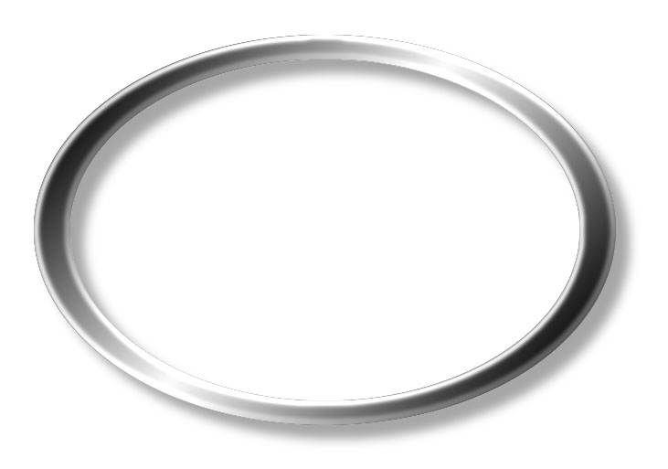

한국노동패널조사
(개인용 설문지 및 가이드)
안녕하십니까?
정부출연연구기관인 한국노동연구원에서는 올바른 노동관련 정부정책의 수립과 실행을 위해 취업실태조사를 실시하고자 합니다.
본 조사의 취지는 급격히 변화하고 있는 경제환경 속에서 고용불안을 느끼고 있는 근로자들의 생활지원 및 취업알선, 직업훈련 등의 제공을 위한 기초자료를 마련하는데 있습니다.
본 설문지의 모든 문항에는 맞고 틀리는 답이 없으므로 선생님의 솔직한 의견을 있는 그대로 대답하여 주시면 감사하겠습니다.
본 조사는 통계법 제33조에 의거하여 실시․관리되므로 설문내용 및 응답자에 대한 모든 비밀은 철저하게 보장되며 모아진 설문지는 전국적으로 수집된 다른 설문지와 함께 통계목적으로만 이용되어 집니다. 이 조사에 대하여 의문사항이 있으시면 한국노동연구원 패널데이터연구실 노동패널팀(전화 044-287-6651∼6654), Fax 044-287-6669)로 연락하여 주십시오.
감사합니다.
**2025. 4**
한국노동연구원

# 예비조사 설문지

※ 지난 조사 당시 일자리가 없는 경우(개인용 인포시트에 표시된 일자리가 없는 경우), 문2로 가십시오.

※ 지난 조사 당시(\_\_\_\_\_년 \_\_\_\_\_월 \_\_\_\_\_일)에 \_\_\_\_\_\_님께서 하신 일에 대해 여쭈어 
보겠습니다.

☞ 먼저 오른쪽 《응답란》 에 개인용 인포시트에 기록되어 있는 내용을 그대로 적어 주십시오.

\_\_\_\_\_\_\_님께서는 지난 조사 당시

확인

⑴ 다음의 응답란(지난 조사당시 응답내용)에 써 있는 직장/사업체/일터에서
⑵ 다음의 응답란(지난 조사당시 응답내용)에 써 있는 일을 주로 하시면서
⑶ 다음의 응답란(지난 조사당시 응답내용)에 써 있는 취업형태를 가지고
계시다고 응답해 주셨습니다.

<u>지난 조사 당시를 기준으로 봤을 때 내용이 맞습니까?</u>

만약 틀리다면 맞는 내용을 바로 아래 칸(지난 조사 당시의 바른 내용)에 적어 주십시오.

(※ 지난 조사 당시 여러 개의 일자리를 가지고 계셨으면 각각의 일자리에 대해 응답해 
 주십시오)

《취업형태》
⑴ 임금근로자 : 타인 또는 회사에 고용되어 보수(돈)를 받고 일한다.(직장, 아르바이트 등)
⑵ 비임금근로자
- 자영업자/고용주 : 내 사업을 한다.(개인사업, 프리랜서, 가게, 십장(오야지), 농림수산업, 행상 및 노점상 등)
- 가족종사자 : 가족(친척)의 일을 일주일에 18시간 이상 돈을 받지 않고 돕는다.

지금도 그 일자리에서 일하고 계십니까? 해당 일자리 옆에 표시해 주십시오.

문 1

(※ 지난 조사 당시 여러 개의 일자리를 가지고 계셨으면 각각의 일자리에 대해 응답해 
 주십시오)

(1) 현재도 그 일을 하고 있다

(2) 지난 조사 당시 이전에 이미 그만두었거나, 지난 조사 이후 그만두었다

(3) 그런 일자리를 가진 적이 없다 → 문2.로 가십시오

《 응답란 : 확인 ～ 문1. 》

<table>
<tr><th rowspan="2">일자리 번호</th><th colspan="4">확인</th><th>문1.</th><th rowspan="2">설문 종류</th></tr>
<tr><td></td><td>직장/사업체명</td><td>주로 하던 일</td><td>취업 형태</td><td>현재 계속 여부</td></tr>
<tr><td rowspan="12">가 1</td><td rowspan="6"><u>지난</u> <u>조사</u> <u>당시</u> 응답내용 (인포시트 그대로)</td><td rowspan="6"></td><td rowspan="6"></td><td rowspan="3">⑴ 임금근로자</td><td>⑴ 현재도 그 일을 하고 있다</td><td>유형1</td></tr>
<tr><td>⑵ 그만두었다</td><td>유형2</td></tr>
<tr><td>⑶ 가진 적이 없다</td><td></td></tr>
<tr><td rowspan="3">⑵ 비임금근로자</td><td>⑴ 현재도 그 일을 하고 있다</td><td>유형3</td></tr>
<tr><td>⑵ 그만두었다</td><td>유형4</td></tr>
<tr><td>⑶ 가진 적이 없다</td><td></td></tr>
<tr><td rowspan="6"><u>지난</u> <u>조사</u> <u>당시</u> 바른내용</td><td rowspan="6"></td><td rowspan="2">1) 주로 하는 일 :</td><td rowspan="3">⑴ 임금근로자</td><td>⑴ 현재도 그 일을 하고 있다</td><td>유형1</td></tr>
<tr><td rowspan="2">⑵ 그만두었다</td><td rowspan="2">유형2</td></tr>
<tr><td rowspan="2">2) 사용 장비나 도구 :</td></tr>
<tr><td rowspan="3">⑵ 비임금근로자</td><td rowspan="2">⑴ 현재도 그 일을 하고 있다</td><td rowspan="2">유형3</td></tr>
<tr><td rowspan="2">3) 부서명 :</td></tr>
<tr><td>⑵ 그만두었다</td><td>유형4</td></tr>
<tr><td rowspan="12">가 2</td><td rowspan="6"><u>지난</u> <u>조사</u> <u>당시</u> 응답내용 (인포시트 그대로)</td><td rowspan="6"></td><td rowspan="6"></td><td rowspan="3">⑴ 임금근로자</td><td>⑴ 현재도 그 일을 하고 있다</td><td>유형1</td></tr>
<tr><td>⑵ 그만두었다</td><td>유형2</td></tr>
<tr><td>⑶ 가진 적이 없다</td><td></td></tr>
<tr><td rowspan="3">⑵ 비임금근로자</td><td>⑴ 현재도 그 일을 하고 있다</td><td>유형3</td></tr>
<tr><td>⑵ 그만두었다</td><td>유형4</td></tr>
<tr><td>⑶ 가진 적이 없다</td><td></td></tr>
<tr><td rowspan="6"><u>지난</u> <u>조사</u> <u>당시</u> 바른내용</td><td rowspan="6"></td><td rowspan="2">1) 주로 하는 일 :</td><td rowspan="3">⑴ 임금근로자</td><td>⑴ 현재도 그 일을 하고 있다</td><td>유형1</td></tr>
<tr><td rowspan="2">⑵ 그만두었다</td><td rowspan="2">유형2</td></tr>
<tr><td rowspan="2">2) 사용 장비나 도구 :</td></tr>
<tr><td rowspan="3">⑵ 비임금근로자</td><td rowspan="2">⑴ 현재도 그 일을 하고 있다</td><td rowspan="2">유형3</td></tr>
<tr><td rowspan="2">3) 부서명 :</td></tr>
<tr><td>⑵ 그만두었다</td><td>유형4</td></tr>
<tr><td rowspan="12">가 3</td><td rowspan="6"><u>지난</u> <u>조사</u> <u>당시</u> 응답내용 (인포시트 그대로)</td><td rowspan="6"></td><td rowspan="6"></td><td rowspan="3">⑴ 임금근로자</td><td>⑴ 현재도 그 일을 하고 있다</td><td>유형1</td></tr>
<tr><td>⑵ 그만두었다</td><td>유형2</td></tr>
<tr><td>⑶ 가진 적이 없다</td><td></td></tr>
<tr><td rowspan="3">⑵ 비임금근로자</td><td>⑴ 현재도 그 일을 하고 있다</td><td>유형3</td></tr>
<tr><td>⑵ 그만두었다</td><td>유형4</td></tr>
<tr><td>⑶ 가진 적이 없다</td><td></td></tr>
<tr><td rowspan="6"><u>지난</u> <u>조사</u> <u>당시</u> 바른내용</td><td rowspan="6"></td><td rowspan="2">1) 주로 하는 일 :</td><td rowspan="3">⑴ 임금근로자</td><td>⑴ 현재도 그 일을 하고 있다</td><td>유형1</td></tr>
<tr><td rowspan="2">⑵ 그만두었다</td><td rowspan="2">유형2</td></tr>
<tr><td rowspan="2">2) 사용 장비나 도구 :</td></tr>
<tr><td rowspan="3">⑵ 비임금근로자</td><td rowspan="2">⑴ 현재도 그 일을 하고 있다</td><td rowspan="2">유형3</td></tr>
<tr><td rowspan="2">3) 부서명 :</td></tr>
<tr><td>⑵ 그만두었다</td><td>유형4</td></tr>
</table>

※ 앞에서 응답했던 일자리를 제외하고 지난 조사 이후 새로 얻으신 일자리에 대해 여쭈어 보겠습니다. (문2. 부터 문4. 까지의 응답내용을 다음의 응답란에 적어주십시오.)

지난 조사 이후 새로 취업하여 1주일 이상 다니신 일자리(직장, 사업, 일거리)가 있습니까? 지난 조사 이후를 곰곰이 돌이켜보아 주십시오.

문 2

※ 지난 조사 당시 응답하지 않았던 일자리가 있었던 경우(인포시트에 지난 조사 당시에는 일자리가 없었던 것으로 표시되어 있었지만 실제로는 지난 조사 당시 일자리를 가지고 있었던 경우)에는 지난 조사 이후 새로 취업한 일자리가 있는 것입니다.

⑴ 있다 → 문3.으로 가십시오.

⑵ 없다 → 문6.으로 가십시오.

지난 조사 이후 새로 취업한 일자리가 있다면,

문 3

⑴ 직장/사업체명은 어떻게 됩니까?

(예 : 성공기계, 풍년상사, 성우건설 아파트 건축현장 등)

⑵ 거기에서 주로 하시는 일은 무엇입니까?

(예 : 동사무소 공공근로, 개인택시, 과외아르바이트, 단추달기 등)

또 다른 일자리가 있었습니까? 있는 대로 모두 말씀해 주십시오.

《일자리》
⑴ 타인, 또는 회사에 고용되어 임금(보수)을 받고 일하거나 (직장, 아르바이트 등)
⑵ 내 사업을 하거나 (예: 개인사업, 프리랜서, 가게, 십장(오야지), 농업, 임업, 수산업, 행상 및 노점상 등)
⑶ 가족(친척)의 일을 돈을 받지 않고 돕는 것(일주일에 18시간 이상)을 말합니다.

《주 의》
새벽시장이나 인력사무소, 인맥(십장 혹은 아는 사람 등)을 통해 매일매일 필요에 의해 고용되고 일거리나 일터가 매우 불규칙한 경우, 다음 기준으로 일자리를 파악합니다.
⑴ 일하는 장소(○○건설현장, ○○식당 등)에서 1주일 이상 안정적으로 일하였다면 하나의 일자리로 파악합니다.
⑵ 일하는 장소가 수시로 바뀌더라도, 중간에 1달 이상의 공백기간이 없이 같은 일(건설 현장 인부, 식당일, 파출부 등)을 계속하였다면, 하나의 일자리로 파악합니다.
⑶ 같은 일을 했더라도 1달 이상의 공백기간이 있을 경우, 예를 들어 1월에 일하고 5월에 일할 경우, 1월에 했던 일과 5월에 했던 일을 다른 일자리로 취급합니다.

※ 문4. 에서 문5. 까지는 문3. 에서 응답한 일자리 각각에 대해 응답해 주십시오.

그 일자리에서 \_\_\_\_\_\_\_님의 취업 형태는 무엇이었습니까? “문4. 취업 형태” 칸에 적어 주십시오.

문 4

⑴ 임금근로자 : 타인, 또는 회사에 고용되어 보수(돈)를 받고 일한다(직장, 아르바이트 등)

⑵ 비임금근로자

- 자영업/고용주 : 내 사업을 한다

(개인사업, 프리랜서, 가게, 십장(오야지), 농림수산업, 행상 및 노점상 등)

- 가족종사자 : 가족(친척)의 일을 일주일에 18시간 이상 돈을 받지 않고 돕는다

지금도 그 일자리에서 일하고 계십니까?

문 5

⑴ 현재도 일하고 있다

⑵ 지금은 그만두었다

《 응답란 : 문3. ～ 문5. 》

<table>
<tr><th rowspan="2">일자리 번호</th><th colspan="2">문3. 지난 조사 이후 새로 구한 일자리</th><th rowspan="2">문4. 취업 형태는?</th><th rowspan="2">문5. 현재에도 그 일을 하고 계십니까?</th><th rowspan="2">설문 종류</th></tr>
<tr><td>⑴ 사업체 이름</td><td>⑵ 주로 하는 일</td></tr>
<tr><td rowspan="6">나 1</td><td rowspan="6"></td><td rowspan="2">1) 주로 하는 일 :</td><td rowspan="3">⑴ 임금근로자</td><td>⑴ 현재에도 일하고 있다</td><td>유형5</td></tr>
<tr><td rowspan="2">⑵ 지금은 그만두었다</td><td rowspan="2">유형6</td></tr>
<tr><td rowspan="2">2) 사용 장비나 도구 :</td></tr>
<tr><td rowspan="3">⑵ 비임금근로자</td><td rowspan="2">⑴ 현재에도 일하고 있다</td><td rowspan="2">유형7</td></tr>
<tr><td rowspan="2">3) 부서명 :</td></tr>
<tr><td>⑵ 지금은 그만두었다</td><td>유형8</td></tr>
<tr><td rowspan="6">나 2</td><td rowspan="6"></td><td rowspan="2">1) 주로 하는 일 :</td><td rowspan="3">⑴ 임금근로자</td><td>⑴ 현재에도 일하고 있다</td><td>유형5</td></tr>
<tr><td rowspan="2">⑵ 지금은 그만두었다</td><td rowspan="2">유형6</td></tr>
<tr><td rowspan="2">2) 사용 장비나 도구 :</td></tr>
<tr><td rowspan="3">⑵ 비임금근로자</td><td rowspan="2">⑴ 현재에도 일하고 있다</td><td rowspan="2">유형7</td></tr>
<tr><td rowspan="2">3) 부서명 :</td></tr>
<tr><td>⑵ 지금은 그만두었다</td><td>유형8</td></tr>
<tr><td rowspan="6">나 3</td><td rowspan="6"></td><td rowspan="2">1) 주로 하는 일 :</td><td rowspan="3">⑴ 임금근로자</td><td>⑴ 현재에도 일하고 있다</td><td>유형5</td></tr>
<tr><td rowspan="2">⑵ 지금은 그만두었다</td><td rowspan="2">유형6</td></tr>
<tr><td rowspan="2">2) 사용 장비나 도구 :</td></tr>
<tr><td rowspan="3">⑵ 비임금근로자</td><td rowspan="2">⑴ 현재에도 일하고 있다</td><td rowspan="2">유형7</td></tr>
<tr><td rowspan="2">3) 부서명 :</td></tr>
<tr><td>⑵ 지금은 그만두었다</td><td>유형8</td></tr>
<tr><td rowspan="6">나 4</td><td rowspan="6"></td><td rowspan="2">1) 주로 하는 일 :</td><td rowspan="3">⑴ 임금근로자</td><td>⑴ 현재에도 일하고 있다</td><td>유형5</td></tr>
<tr><td rowspan="2">⑵ 지금은 그만두었다</td><td rowspan="2">유형6</td></tr>
<tr><td rowspan="2">2) 사용 장비나 도구 :</td></tr>
<tr><td rowspan="3">⑵ 비임금근로자</td><td rowspan="2">⑴ 현재에도 일하고 있다</td><td rowspan="2">유형7</td></tr>
<tr><td rowspan="2">3) 부서명 :</td></tr>
<tr><td>⑵ 지금은 그만두었다</td><td>유형8</td></tr>
<tr><td rowspan="6">나 5</td><td rowspan="6"></td><td rowspan="2">1) 주로 하는 일 :</td><td rowspan="3">⑴ 임금근로자</td><td>⑴ 현재에도 일하고 있다</td><td>유형5</td></tr>
<tr><td rowspan="2">⑵ 지금은 그만두었다</td><td rowspan="2">유형6</td></tr>
<tr><td rowspan="2">2) 사용 장비나 도구 :</td></tr>
<tr><td rowspan="3">⑵ 비임금근로자</td><td rowspan="2">⑴ 현재에도 일하고 있다</td><td rowspan="2">유형7</td></tr>
<tr><td rowspan="2">3) 부서명 :</td></tr>
<tr><td>⑵ 지금은 그만두었다</td><td>유형8</td></tr>
<tr><td rowspan="6">나 6</td><td rowspan="6"></td><td rowspan="2">1) 주로 하는 일 :</td><td rowspan="3">⑴ 임금근로자</td><td>⑴ 현재에도 일하고 있다</td><td>유형5</td></tr>
<tr><td rowspan="2">⑵ 지금은 그만두었다</td><td rowspan="2">유형6</td></tr>
<tr><td rowspan="2">2) 사용 장비나 도구 :</td></tr>
<tr><td rowspan="3">⑵ 비임금근로자</td><td rowspan="2">⑴ 현재에도 일하고 있다</td><td rowspan="2">유형7</td></tr>
<tr><td rowspan="2">3) 부서명 :</td></tr>
<tr><td>⑵ 지금은 그만두었다</td><td>유형8</td></tr>
<tr><td rowspan="6">나 7</td><td rowspan="6"></td><td rowspan="2">1) 주로 하는 일 :</td><td rowspan="3">⑴ 임금근로자</td><td>⑴ 현재에도 일하고 있다</td><td>유형5</td></tr>
<tr><td rowspan="2">⑵ 지금은 그만두었다</td><td rowspan="2">유형6</td></tr>
<tr><td rowspan="2">2) 사용 장비나 도구 :</td></tr>
<tr><td rowspan="3">⑵ 비임금근로자</td><td rowspan="2">⑴ 현재에도 일하고 있다</td><td rowspan="2">유형7</td></tr>
<tr><td rowspan="2">3) 부서명 :</td></tr>
<tr><td>⑵ 지금은 그만두었다</td><td>유형8</td></tr>
<tr><td rowspan="5">나 8</td><td rowspan="5"></td><td rowspan="2">1) 주로 하는 일 :</td><td rowspan="3">⑴ 임금근로자</td><td>⑴ 현재에도 일하고 있다</td><td>유형5</td></tr>
<tr><td rowspan="2">⑵ 지금은 그만두었다</td><td rowspan="2">유형6</td></tr>
<tr><td rowspan="2">2) 사용 장비나 도구 :</td></tr>
<tr><td rowspan="2">⑵ 비임금근로자</td><td>⑴ 현재에도 일하고 있다</td><td>유형7</td></tr>
<tr><td>3) 부서명 :</td><td>⑵ 지금은 그만두었다</td><td>유형8</td></tr>
</table>

현재 가지고 있는 일자리 중 어느 일자리가 가장 중요한 일자리입니까? 일자리가 여러 개일 경우 가장 중요한 일자리의 일자리 번호를 응답하여 주십시오.

문 6

(가장 중요한 일자리에는 \_\_\_\_\_\_\_님께서 판단하시기에 가장 중요한 일자리를 적어 주시면 됩니다. 혹시 판단하기 어려우시면, 가장 많은 시간 동안 일하는 일자리를 적어주시면 됩니다. 일하는 시간도 동일할 경우 수입이 가장 많은 일자리를 응답해 주시면 됩니다.)

응답 예) 나 1

￭\_\_\_\_\_\_\_\_\_\_\_\_\_\_\_\_\_\_\_\_\_\_\_\_\_\_\_\_\_\_

(98) 미취업자 (→ 유형 1, 3, 5, 7이 없는 응답자)

## 면접원 유의사항

1. 개인용 예비조사 설문과 개인용 공통 설문(취업자용, 미취업자용)은 15세 이상의 모든 가구원에게 응답받습니다.

2. 아래의 기준으로 개인 유형 설문을 결정합니다.

<table>
<tr><th>지난 조사당시 일자리</th><th>취업 형태</th><th>현재 계속 여부</th><th>유형 판정</th></tr>
<tr><td rowspan="4">있었다</td><td rowspan="2">임 금</td><td>현재도 하고 있다</td><td>유형1</td></tr>
<tr><td>지금은 그만두었다</td><td>유형2</td></tr>
<tr><td rowspan="2">비임금</td><td>현재도 하고 있다</td><td>유형3</td></tr>
<tr><td>지금은 그만두었다</td><td>유형4</td></tr>
<tr><td>없었다</td><td>미취업</td><td>유형설문 없음</td><td></td></tr>
</table>

<table>
<tr><th>새로 시작한 일자리 여부</th><th>취업 형태</th><th>현재 계속 여부</th><th>유형 판정</th></tr>
<tr><td rowspan="4">있었다</td><td rowspan="2">임 금</td><td>현재도 하고 있다</td><td>유형5</td></tr>
<tr><td>지금은 그만두었다</td><td>유형6</td></tr>
<tr><td rowspan="2">비임금</td><td>현재도 하고 있다</td><td>유형7</td></tr>
<tr><td>지금은 그만두었다</td><td>유형8</td></tr>
<tr><td>없었다</td><td>미취업</td><td>유형설문 없음</td><td></td></tr>
</table>

3. 개인용 공통 설문의 판별 (취업자용과 미취업자용)

\* 현재 일자리를 가지고 있는 경우(유형 설문 1, 3, 5, 7중에 하나라도 응답한 경우)에는

취업자 개인 설문을 하셔야 합니다.

\* 현재 일자리를 가지고 있지 않은 경우에는 미취업자 개인 설문을 하셔야 합니다.

4. 설문이 끝나면 개인별로 모든 설문을 하나로 묶어 제본, 보관합니다.

## 파견/용역의 경우 일자리 판단

□ 파견되어 있거나 소속이 용역업체로 되어 있는 경우에 일자리나 일자리에서의 종업원 수, 4대보험 가입여부, 복리후생 등에 대해서는 다음과 같이 판단합니다.

1. 파견업체나 용역업체에서 파견되어 일하는 경우
 (예: 파견업체에서 파견된 국민은행 영등포 지점 청원경찰의 경우)

| 일자리  판단 | 현재 일하는 곳을 기준으로 (1) 1달 이상의 공백기간이 있는 경우 새로 구한 일자리로 (2) 1달 이상의 공백기간이 없는 경우 지속적인 일자리로 보고 이름만 바뀐 것으로 ※ 특기사항 - 파견업체에 소속되어 있으면서 1달 이상 공백이 있는 기간 중에 파견업체로부터   받은 돈은 미취업자의 "이전 소득"임 |
| --- | --- |
| 일자리 이름 (유형) | 현재 일하고 있는 곳 (국민은행 영등포 지점) |
| 종업원 수 (유형) | (1) 전체 종업원 수는 국민은행 전체의 종업원 수 (2) 실제 사업장의 종업원 수는 국민 은행 영등포 지점의 종업원 수 |
| 4대 보험 (유형) | 용역업체에서 제공하건, 현재 일하고 있는 일자리에서 제공하건 4대 보험 가입여부에 응답 (국민연금, 건강보험의 지역가입자는 제외) |
| 복리 후생 (취업) | 현재 일하고 있는 일자리에서 제공하는 복리후생을 기준으로 (파견업체나 용역업체에서 제공하는 것은 제외) |

2. 파견업체나 용역업체 소속이 아닌 경우

(예: 파스퇴르에서 백화점 매장에 파견 / IT 업체에서 여기저기 파견을 다니면서 일하는 경우 등)

| 일자리  판단 | 먼저 파견 시점이 지나면, 고용계약이 끝나는지를 질문하여 (1) 끝난다면 -> 파견임, ‘1번’ 경우를 참조하여 판단 (2) 끝나지 않고 본사로 복귀한다면 -> 외근임, 일자리가 바뀌어도 지속적인 일자리로 판단 |
| --- | --- |
| 일자리 이름 (유형) | (1) 파견인 경우 : ‘1번’ 경우를 참조하여 판단 (2) 외근인 경우: 일자리명은 외근 나가 있는 곳의 이름(OO백화점 파스퇴르 판매처) |
| 종업원 수 (유형) | (1) 파견인 경우 : ① 전체 종업원 수는 OO백화점 전체의 종업원 수 ② 실제 사업장의 종업원 수는 OO백화점 OO점의 종업원 수 (2) 외근인 경우: ① 전체 종업원 수는 파스퇴르 본사의 종업원 수 ② 실제 사업장의 종업원 수는 OO백화점 파스퇴르 판매처의 종업원 수 |
| 4대 보험 (유형) | 용역업체에서 제공하건, 현재 일하고 있는 일자리에서 제공하건 4대 보험 가입여부에 응답 (국민연금, 건강보험의 지역가입자는 제외) |
| 복리 후생 (취업) | (1) 파견인 경우 : ‘1번’ 경우를 참조하여 판단 (2) 외근인 경우: 파스퇴르에서 제공하는 복리후생 기준 |

3. 파견업체나 용역업체에서 파견되어 일하다가 정식직원으로 채용된 경우

| 일자리  판단 | 지속되는 일자리로 판단하여 ‘유형1’을 받음 |
| --- | --- |
| 일자리 이름 (유형) | 정직원이므로 보통 응답받듯이 일자리 기준으로 받음 |
| 종업원 수 (유형) | 정직원이므로 보통 응답받듯이 일자리 기준으로 받음 |
| 4대 보험 (유형) | 정직원이므로 보통 응답받듯이 일자리 기준으로 받음 |
| 복리 후생 (취업) | 정직원이므로 보통 응답받듯이 일자리 기준으로 받음 |

4. 용역업체를 통해 일감을 받아 일을 나가는 사람의 경우

| 일자리  판단 | 먼저 용역업체에서 일한 날수와 관계없이 월임금을 받는지, 날수에 따라 돈을 받는지 질문한 후 (1) 일한 날수 또는 건수에 따라 임금을 받는다면 -> 일용직 또는 파견 : ‘1번’ 경우 참조 (2) 월임금을 받는다면 -> 외근 : 일자리가 바뀌어도 지속적인 일자리로 판단 |
| --- | --- |
| 일자리 이름 (유형) | (1) 파견인 경우 : ‘1번’ 경우를 참조하여 판단 (2) 외근인 경우: ‘2번’ 경우를 참조하여 판단 |
| 종업원 수 (유형) | (1) 파견인 경우 : ‘1번’ 경우를 참조하여 판단 (2) 외근인 경우: ‘2번’ 경우를 참조하여 판단 |
| 4대 보험 (유형) | (1) 파견인 경우 : ‘1번’ 경우를 참조하여 판단 (2) 외근인 경우: ‘2번’ 경우를 참조하여 판단 |
| 복리 후생 (취업) | (1) 파견인 경우 : ‘1번’ 경우를 참조하여 판단 (2) 외근인 경우: ‘2번’ 경우를 참조하여 판단 |